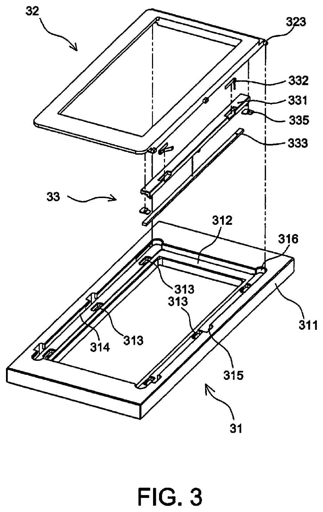
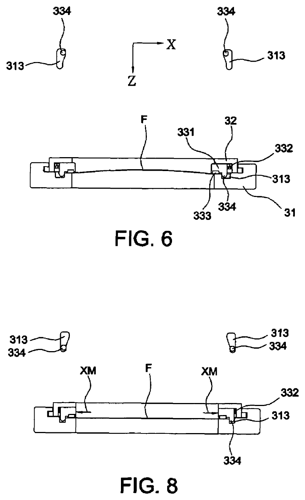

# Film holder

Sliding the lid drives a guided, frictional film-flattening element.

[US7210259B2 · complete original PDF (11 pages)](../sources/US7210259B2.pdf) · [Archival PDF source](https://patentimages.storage.googleapis.com/54/dc/98/118bf1162ef46a/US7210259.pdf) · [Searchable publication](https://patents.google.com/patent/US7210259B2/en) · [Espacenet](https://worldwide.espacenet.com/patent/search?q=pn%3DUS7210259B2)

## Original drawings

<figure>

<figcaption>Fig. 3. Exploded carrier showing base and sliding lid. <a href="../sources/US7210259B2.pdf#page=4">US7210259B2, PDF p. 4</a>.</figcaption>
</figure>
<figure>

<figcaption>Figs. 6 and 8. Sections comparing the holder mechanism in two positions. <a href="../sources/US7210259B2.pdf#page=7">US7210259B2, PDF p. 7</a>.</figcaption>
</figure>

## Publication

- **Publication** US7210259B2
- **Inventors** Kuang Yao Liu
- **Original assignee** Microtek International Inc.
- **Priority** 2004-08-18 · **Filing** 2005-02-03 · **Publication** 2007-05-01
- **Original application** Film scanner
- **Mechanisms** Mechanical clamping, Edge grip, Lateral tension, Combined mechanisms

## What the patent describes

**Original problem.** A conventional flexible-arm carrier had limited frictional travel, leaving some film sufficiently curved to lose scan focus.

**Operating sequence.** Load film on the base panel and mount the cover. As the cover slides, cylindrical followers travel in shaped slots, displacing a spring-biased rod and its contact plate. Reverse the sliding movement to release the grip.

**Film contact.** The contact plate and film panel meet the film, with mechanisms positioned near the carrier sides.

**Transverse control.** The shaped guides drive the contact plate across the film as the lid slides along its track. Friction transmits the flattening stroke.

**Longitudinal control.** The film panel sets the along-length reference. The patent does not show a second independently driven end stretch.

## Engineering interpretation

**Advantages and limits.** A small manual motion generates repeatable lateral displacement. Travel, force and surface friction determine where the film actually moves.

**Camera scanning.** A passive cross-motion linkage could be driven by an actuator. Measure grip displacement independently of lid displacement.

## Commercial evidence and sources

Commercial deployment of the disclosed mechanism is unverified in the sources reviewed.

## Related patents

[US2824491A · Film holder](US2824491A.md) · [US5028956A · Film clamp](US5028956A.md) · [US6002469A · Apparatus for tensioning copy masters](US6002469A.md) · [US20240364825A1 · Film clamping device](US20240364825A1.md)

**Selected indexed prior references.** [US3974582A](https://patents.google.com/patent/US3974582A/en) · [US4051487A](https://patents.google.com/patent/US4051487A/en) · [US4942684A](https://patents.google.com/patent/US4942684A/en) · [US5073022A](https://patents.google.com/patent/US5073022A/en)

[Return to the archive](../index.md)
