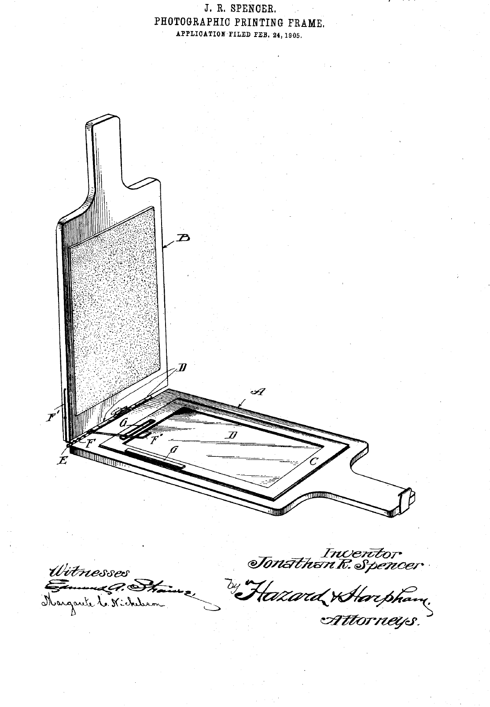

# Photographic-printing frame

A hinged printing frame brings sensitized paper against a negative on glass.

[US813531A · complete original PDF (2 pages)](../sources/US813531A.pdf) · [Archival PDF source](https://patentimages.storage.googleapis.com/cc/7a/bb/6c772c84e769ee/US813531.pdf) · [Searchable publication](https://patents.google.com/patent/US813531A/en) · [Espacenet](https://worldwide.espacenet.com/patent/search?q=pn%3DUS813531A)

## Original drawings

<figure>

<figcaption>Drawing sheet. Printing frame open on its hinge, showing the glass and backing assembly. <a href="../sources/US813531A.pdf#page=1">US813531A, PDF p. 1</a>.</figcaption>
</figure>

## Publication

- **Publication** US813531A
- **Inventors** Jonathan R Spencer
- **Original assignee** Individual
- **Priority** 1905-02-24 · **Filing** 1905-02-24 · **Publication** 1906-02-27
- **Original application** Reproduction and copying
- **Mechanisms** Glass-based support, Mechanical clamping

## What the patent describes

**Original problem.** The printing frame needed to control alignment and contact between a negative and photosensitive paper during repeated handling.

**Operating sequence.** A glass negative frame and hinged back let the operator assemble the stack, press it together and inspect or change it.

**Film contact.** The negative lies on the glass face with printing paper against its opposite side.

**Transverse control.** The glass spans the width of the negative.

**Longitudinal control.** The same rigid surface spans its length, with closing pressure supplied from the back.

## Engineering interpretation

**Advantages and limits.** The contact stack is simple and shows why surface cleanliness matters. The apparatus is manually loaded and intended for direct printing.

**Camera scanning.** An early reference for capture-only plate contact. A scan fixture would need repeatable opening and clean separation of the two faces.

## Commercial evidence and sources

Commercial deployment of the disclosed mechanism is unverified in the sources reviewed.

## Related patents

[US1581999A · Enlargement printer](US1581999A.md) · [US2741154A · Negative holder and carrier](US2741154A.md)

**Selected indexed later citations.** [US2741154A](https://patents.google.com/patent/US2741154A/en) · [US4089604A](https://patents.google.com/patent/US4089604A/en) · [US4111550A](https://patents.google.com/patent/US4111550A/en)

[Return to the archive](../index.md)
