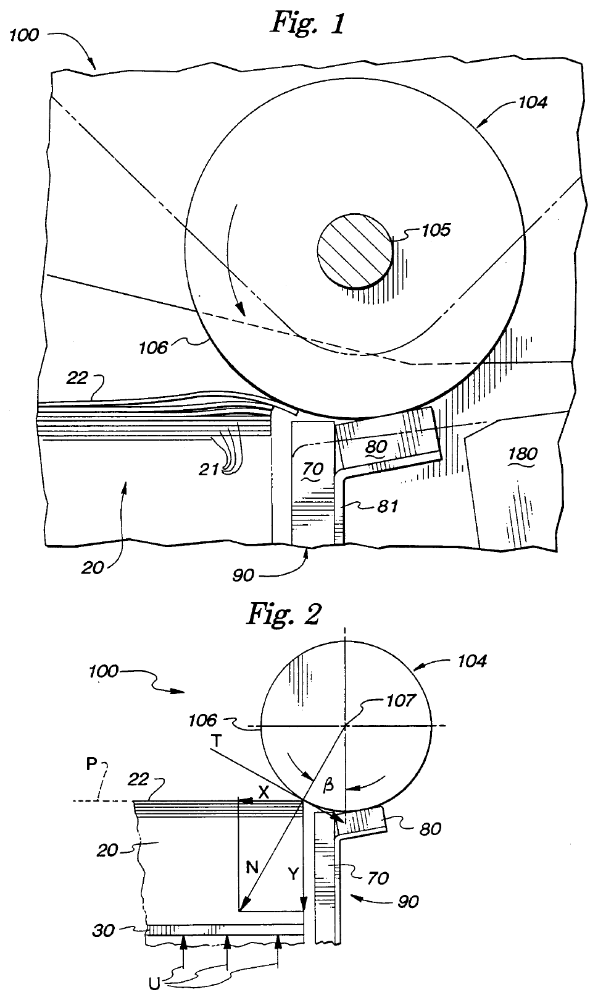
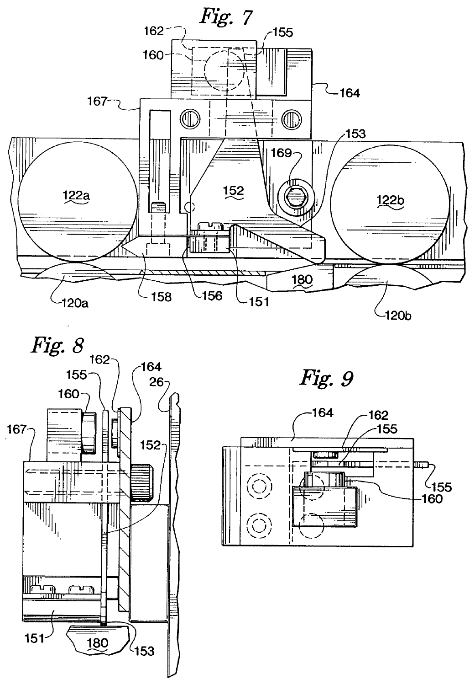

# Single sheet picking and transport mechanism

An offset pick roller loads the exposed sheet edge while a dam and spring-biased pad guide and separate it.

[EP0405466B1 · complete original PDF (24 pages)](../sources/EP0405466B1.pdf) · [Original PDF source](https://data.epo.org/publication-server/rest/v1.2/patents/EP0405466NWB1/document.pdf) · [Searchable publication](https://patents.google.com/patent/EP0405466B1/en) · [Espacenet](https://worldwide.espacenet.com/patent/search?q=pn%3DEP0405466B1)

## Original drawings

<figure>

<figcaption>Figs. 1–2. Pick roller, dam, pad and force vectors at the aligned stack edge. <a href="../sources/EP0405466B1.pdf#page=14">EP0405466B1, PDF p. 14</a>.</figcaption>
</figure>
<figure>

<figcaption>Figs. 7–9. Thickness-sensing mechanism positioned between downstream feed roller pairs. <a href="../sources/EP0405466B1.pdf#page=22">EP0405466B1, PDF p. 22</a>.</figcaption>
</figure>

## Publication

- **Publication** EP0405466B1
- **Inventors** Walter Gysling
- **Original assignee** National Computer Systems Inc
- **Priority** 1989-06-30 · **Filing** 1990-06-26 · **Publication** 1995-01-18
- **Application** Paper and document feeder
- **Mechanisms** Friction pickup, Retard pad or roller, Gate or edge selection, Presence or double-feed detection, Combined mechanisms

## What the patent describes

**Problem.** Top rollers pressed directly down on a stack can transmit normal load through many sheets, increasing inter-sheet traction and allowing multiple sheets to move together.

**Stack presentation.** Aligned leading edges are presented by a pivoted, spring-loaded tray that is intended to maintain nearly constant force against the pick as the pile height changes.

**Pickup sequence.** The arcuate roller approaches the exposed top edge at an offset rather than tangentially pressing the broad face. The roller moves the outer sheet slightly down and out of the stack.

**Contact surfaces.** The roller engages the exposed edge and adjacent surface. The dam touches the edge and opposite face. A biased friction pad and the downstream transport rollers contact opposite surfaces.

**Separation and overlap.** The rolling geometry reduces broad compression between sheets and introduces a normal-force component opposing multi-pick. The dam directs the selected edge to the retard pad. A thickness sensor checks the sheet after the throat and later optical sensors check skew.

**Handoff.** After the leading edge is past the downstream driven roller pair, the pick clutch releases. The outgoing sheet can freewheel the pick roller as the transport takes over.

## Engineering interpretation

This case connects load direction, stack-height compensation, and positive traction overlap. A curled cut frame might reach the roller inboard of the intended edge. Test lead-edge height and bending force before treating document settings as suitable for film.

**Media and length evidence.** The stated media and geometry establish the application on this page. Published pickup limits for loose, cut 35 mm strips remain unverified.

## Commercial evidence

The patent describes optically scanned document applications. A production unit with this exact feeder was not established.

## Related patents

[US3469834A · Sheet feeder and separator apparatus](US3469834A.md) · [EP0521459A1 · Device for feeding single sheets out of a stack of film sheets](EP0521459A1.md) · [EP1721846B1 · Media separator mechanism](EP1721846B1.md) · [US7654522B2 · Sheet feeder with ultrasonic double feed detector](US7654522B2.md)

[Return to the pickup and separation archive](../index.md)
