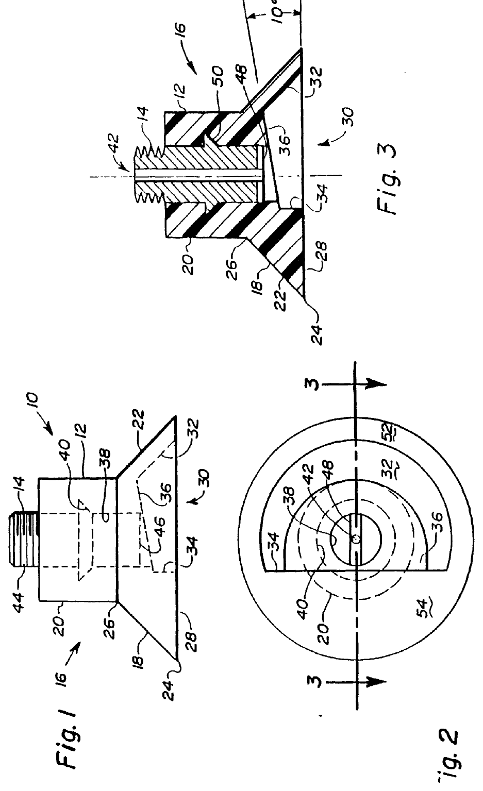
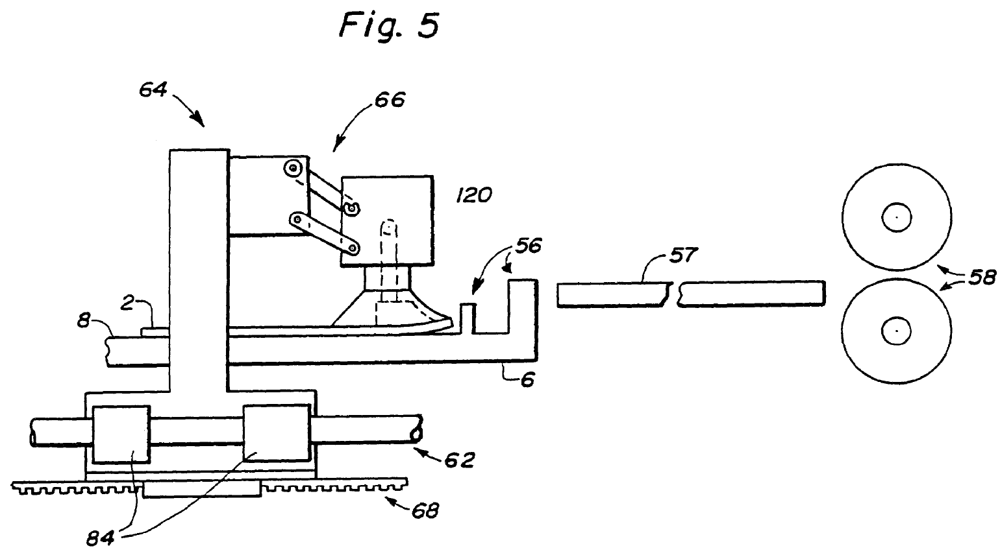
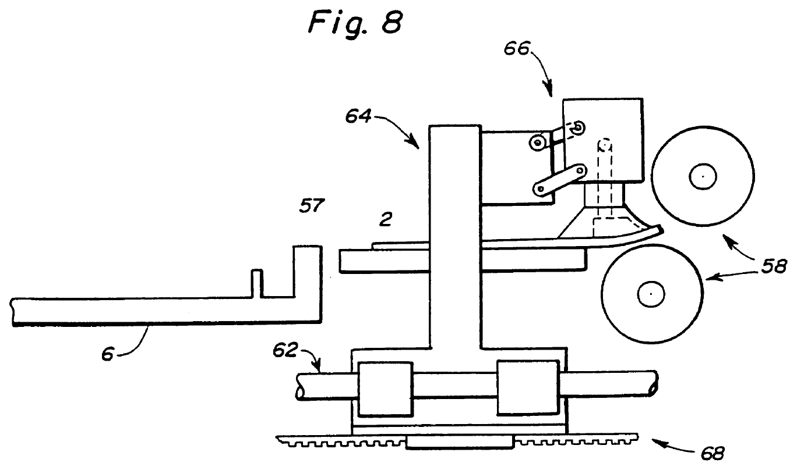

# Method and apparatus for moving a sheet

A suction cup with lips of unequal thickness curls a film edge away from an intensifying screen.

[EP0467203B1 · complete original PDF (18 pages)](../sources/EP0467203B1.pdf) · [Original PDF source](https://data.epo.org/publication-server/rest/v1.2/patents/EP0467203NWB1/document.pdf) · [Searchable publication](https://patents.google.com/patent/EP0467203B1/en) · [Espacenet](https://worldwide.espacenet.com/patent/search?q=pn%3DEP0467203B1)

## Original drawings

<figure>

<figcaption>Figs. 1-3. Side, underside and section views of the unequal-thickness suction cup. <a href="../sources/EP0467203B1.pdf#page=10">EP0467203B1, PDF p. 10</a>.</figcaption>
</figure>
<figure>

<figcaption>Fig. 5. The lip curls the film edge away from the cassette surface after vacuum is applied. <a href="../sources/EP0467203B1.pdf#page=12">EP0467203B1, PDF p. 12</a>.</figcaption>
</figure>
<figure>

<figcaption>Fig. 8. Pickup linkage moving the lifted edge to the transport nip. <a href="../sources/EP0467203B1.pdf#page=15">EP0467203B1, PDF p. 15</a>.</figcaption>
</figure>

## Publication

- **Publication** EP0467203B1
- **Inventors** Robert Winfield Chambers
- **Original assignee** Sterling Diagnostic Imaging Inc
- **Priority** 1990-07-16 · **Filing** 1991-07-10 · **Publication** 1996-10-09
- **Application** Film cassette handling
- **Mechanisms** Vacuum pickup, Bending and peeling

## What the patent describes

**Problem.** Closing a radiographic cassette expels air between film and screen. A conventional cup can have difficulty breaking this interface within the feed cycle.

**Stack presentation.** The example opens a light-tight X-ray cassette. The patent also applies the cup to tightly stacked sheets.

**Pickup sequence.** The cup contacts the sheet close to its edge. Under vacuum the thin arcuate lip flexes upward while the thicker part retains more of its original shape.

**Contact surfaces.** A resilient annular face surrounds the suction recess. The deforming lip lifts the film immediately under it.

**Separation and overlap.** Asymmetric cup deformation raises part of the edge and creates an opening for air. The cup then draws the sheet clear of any obstruction.

**Handoff.** A linkage translates the suction assembly across the support and delivers the leading edge to the nip of feed rollers.

## Engineering interpretation

Cup material and rim geometry supply the initial peel without a separate tilt actuator. Orientation becomes critical when the usable film face is narrow or already bowed.

**Media and length evidence.** The stated media and geometry establish the application on this page. Published pickup limits for loose, cut 35 mm strips remain unverified.

## Commercial evidence

The patent depicts a cassette unloader and film roller handoff. The exact asymmetric lip was not verified in a named production model.

## Related patents

[US4979729A · Suction device for removing film sheets](US4979729A.md) · [EP0512084B1 · Sheet-film removal device](EP0512084B1.md) · [WO2004079448A1 · Film sheet supply system](WO2004079448A1.md)

[Return to the pickup and separation archive](../index.md)
