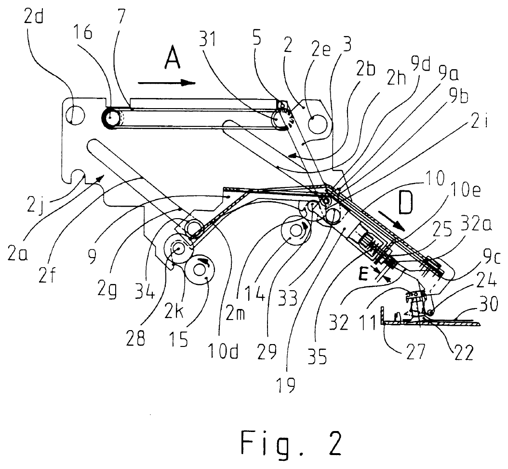
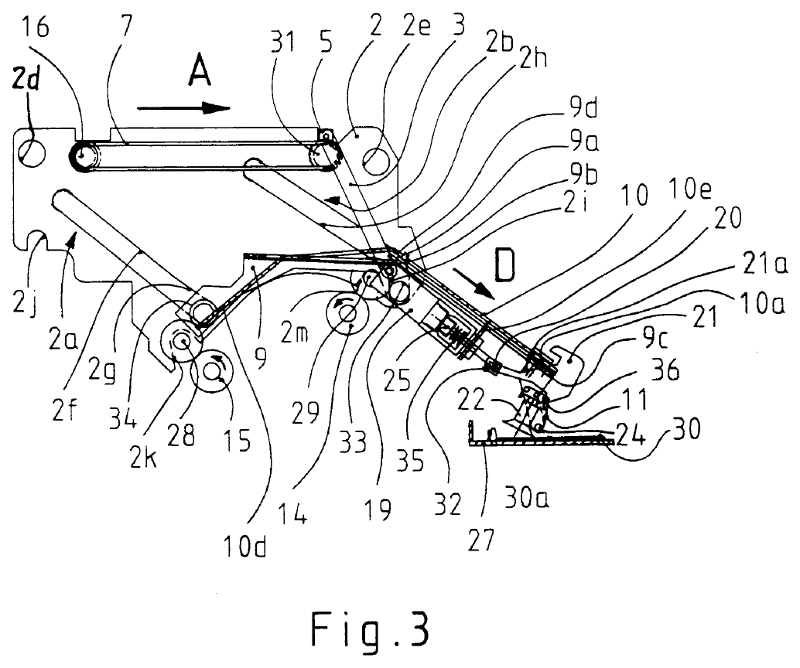
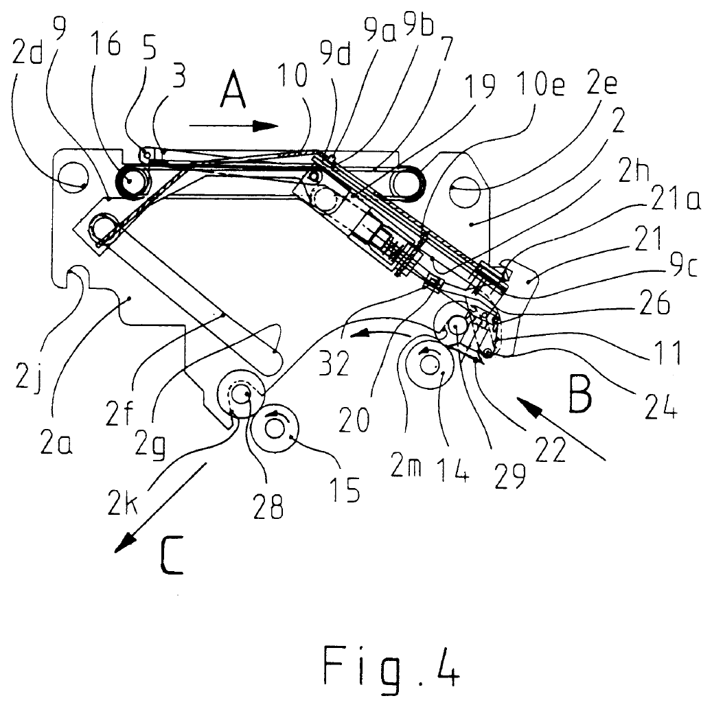

# Sheet-film removal device

A tilting suction plate peels film from an opened cassette and senses when the cups have sealed to the rigid base.

[EP0512084B1 · complete original PDF (13 pages)](../sources/EP0512084B1.pdf) · [Original PDF source](https://data.epo.org/publication-server/rest/v1.2/patents/EP0512084NWB1/document.pdf) · [Searchable publication](https://patents.google.com/patent/EP0512084B1/en) · [Espacenet](https://worldwide.espacenet.com/patent/search?q=pn%3DEP0512084B1)

## Original drawings

<figure>

<figcaption>Fig. 2. Carriage position that presents the suction plate to the film. <a href="../sources/EP0512084B1.pdf#page=11">EP0512084B1, PDF p. 11</a>.</figcaption>
</figure>
<figure>

<figcaption>Fig. 3. Spring-driven tilt with the front edge peeled clear of the cassette. <a href="../sources/EP0512084B1.pdf#page=12">EP0512084B1, PDF p. 12</a>.</figcaption>
</figure>
<figure>

<figcaption>Fig. 4. Upper carriage position and the downstream transport rollers. <a href="../sources/EP0512084B1.pdf#page=13">EP0512084B1, PDF p. 13</a>.</figcaption>
</figure>

## Publication

- **Publication** EP0512084B1
- **Inventors** Guenter Weber, Gerd Hoitz
- **Original assignee** Kodak GmbH
- **Priority** 1990-11-23 · **Filing** 1991-11-15 · **Publication** 1995-03-22
- **Application** Film cassette handling
- **Mechanisms** Vacuum pickup, Bending and peeling, Presence or double-feed detection, Combined mechanisms

## What the patent describes

**Problem.** A film remover must approach tilted or bowed film gently and recover when the cassette is empty and the cups instead adhere to its backing.

**Stack presentation.** The mechanism approaches an opened exposed-film cassette at an angle. The carrier and suction plate accommodate height, tilt and curl of the presented sheet.

**Pickup sequence.** A toothed-belt-driven carriage follows paired guide slots that slow descent near contact. The electromagnet presents the suction plate, then a spring tilts the plate after vacuum engages.

**Contact surfaces.** Suction elements contact the front region of the film. The cassette or intensifying screen supports the sheet until the edge is peeled.

**Separation and overlap.** The powered plate tilt bends the front edge away from the backing. If the cups seal to a rigid surface and the plate cannot tilt, the associated switch reports the failed motion and the control vents the head.

**Handoff.** The carriage reverses and carries the lifted sheet toward the pair of transport rollers.

## Engineering interpretation

A position signal can detect rigid-base pickup in addition to vacuum pressure. The design addresses removal from a cassette. A separate check would still be needed to count overlapping loose negatives.

**Media and length evidence.** The stated media and geometry establish the application on this page. Published pickup limits for loose, cut 35 mm strips remain unverified.

## Commercial evidence

The publication describes equipment for exposed sheet film. Deployment of the specific tilting carriage and empty-cassette interlock remains unverified.

## Related patents

[EP0467203B1 · Method and apparatus for moving a sheet](EP0467203B1.md) · [US4979729A · Suction device for removing film sheets](US4979729A.md) · [WO2004079448A1 · Film sheet supply system](WO2004079448A1.md)

[Return to the pickup and separation archive](../index.md)
