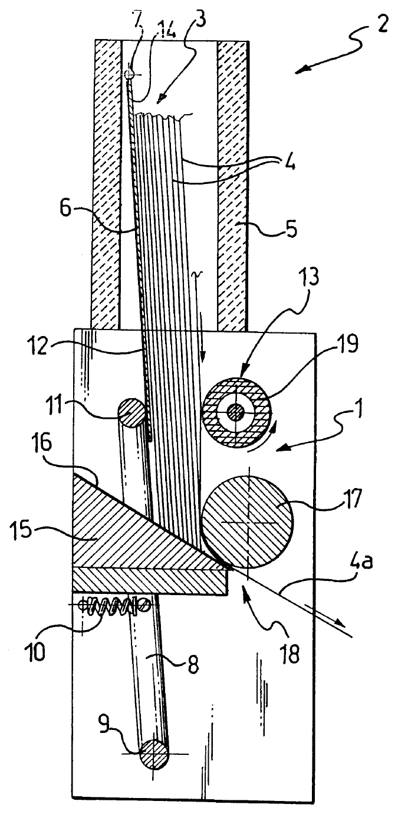

# Device for feeding single sheets out of a stack of film sheets

A near-upright film magazine combines roller traction and a bending threshold in a generous throat.

[EP0521459A1 · complete original PDF (5 pages)](../sources/EP0521459A1.pdf) · [Original PDF source](https://data.epo.org/publication-server/rest/v1.2/patents/EP0521459NWA1/document.pdf) · [Searchable publication](https://patents.google.com/patent/EP0521459A1/en) · [Espacenet](https://worldwide.espacenet.com/patent/search?q=pn%3DEP0521459A1)

## Original drawings

<figure>

<figcaption>Drawing sheet. Section through the spring-biased film stack, elastomer drive roller, tilted wedge and rounded withdrawal passage. <a href="../sources/EP0521459A1.pdf#page=4">EP0521459A1, PDF p. 4</a>.</figcaption>
</figure>

## Publication

- **Publication** EP0521459A1
- **Inventors** Renato Bolognese, Marco Notini, Gian Carlo Pastorino
- **Original assignee** Minnesota Mining and Manufacturing Company
- **Priority** 1991-07-03 · **Filing** 1992-06-30 · **Publication** 1993-01-07
- **Application** Radiographic sheet film
- **Mechanisms** Friction pickup, Bending and peeling, Gate or edge selection, Combined mechanisms

## What the patent describes

**Problem.** Calibrated slots, exact-height claws, and vacuum heads were described as sources of tight tolerances, artifacts, complexity, or cost in X-ray film feeding.

**Stack presentation.** A spring and hinged lever urge the substantially upright stack against a driven feed roller as the magazine empties.

**Pickup sequence.** The roller grips the outer film sheet and pushes it down to an inclined fixed wedge. The specified static traction against the roller exceeds that between film sheets.

**Contact surfaces.** The elastomer feed roller touches the outer face. The leading sheet bends between the oblique wedge face and a rounded, preferably rotating, opposing guide.

**Separation and overlap.** The passageway opening is at least twice the film thickness. Selection instead relies on the roller delivering enough force to bend the contacted sheet while friction transferred to the neighboring sheet is too low to bend that sheet into the curved path.

**Handoff.** The selected sheet exits through the rounded guide and withdrawal opening. The illustrated magazine leaves the following transport unspecified.

## Engineering interpretation

This is a direct film precedent for the project's passive separator idea. Negative curl, stiffness, surface orientation and cut length can shift the force window. The geometry also controls whether a short outgoing tail rubs the adjacent film.

**Media and length evidence.** The stated media and geometry establish the application on this page. Published pickup limits for loose, cut 35 mm strips remain unverified.

## Commercial evidence

An X-ray film supply magazine is the disclosed use. No catalogued machine has been matched to this specific wedge, roller and follower combination.

## Related patents

[US4179114A · Film sheet handling device](US4179114A.md) · [EP0405466B1 · Single sheet picking and transport mechanism](EP0405466B1.md) · [US6556276B2 · Photographic reorder system and method](US6556276B2.md)

[Return to the pickup and separation archive](../index.md)
