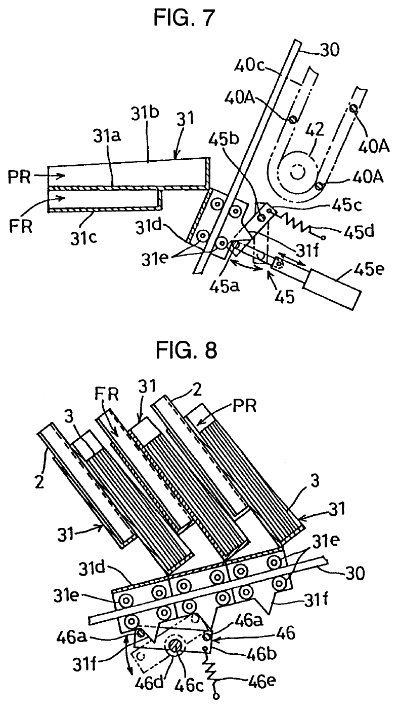

# Photographic printing apparatus

A stopper meters individual job receptacles that carry prints and cut-film holders through a photofinishing line.

[EP0750228A1 · complete original PDF (21 pages)](../sources/EP0750228A1.pdf) · [Original PDF source](https://data.epo.org/publication-server/rest/v1.2/patents/EP0750228NWA1/document.pdf) · [Searchable publication](https://patents.google.com/patent/EP0750228A1/en) · [Espacenet](https://worldwide.espacenet.com/patent/search?q=pn%3DEP0750228A1)

## Original drawings

<figure>

<figcaption>Figs. 7–8. Station stop and the waiting-station escapement releasing individual receptacles. <a href="../sources/EP0750228A1.pdf#page=14">EP0750228A1, PDF p. 14</a>.</figcaption>
</figure>

## Publication

- **Publication** EP0750228A1
- **Inventors** Toshio Doi, Hiroshi Miyawaki
- **Original assignee** Noritsu Koki Co., Ltd.
- **Priority** 1995-06-20 · **Filing** 1996-06-20 · **Publication** 1996-12-27
- **Application** Photofinishing receptacles
- **Mechanisms** Gate or edge selection, Presence or double-feed detection, Combined mechanisms

## What the patent describes

**Problem.** A lab printer needed to keep finished prints associated with the correct processed negatives while conveyor sections operate at different rates.

**Stack presentation.** The waiting station queues rigid receptacles on a sloping circulating guide. Each receptacle has distinct positions for prints and the film holder.

**Pickup sequence.** A photoelectric sensor checks for an empty receptacle when the chain is ready. A rotary-solenoid-driven stopper turns so the foremost one can roll down the guide.

**Contact surfaces.** Stopper catches, guide rollers and conveyor chains act on the rigid receptacle. In a later station a retainer arm controls the film holder.

**Separation and overlap.** The next catch meets a following guide roller. Each actuation releases one receptacle while the rest of the queue remains held.

**Handoff.** Gravity moves the released unit to a chain with linking pins. Moving the receptacle and moving its film holder are separate operations in the described line.

## Engineering interpretation

A rigid carrier transfers the difficult separation geometry from fragile film to a part designed for handling. An automated source of those carriers would be a separate engineering problem for the original loose stack.

**Media and length evidence.** The line cuts negatives into four- or six-frame strips and inserts them into holders. The metered object in the waiting station is the receptacle, without direct selection of a loose strip.

## Commercial evidence

The original application names Noritsu Koki. It does not verify that a particular production printer used the illustrated receptacle queue.

## Related patents

[US6556276B2 · Photographic reorder system and method](US6556276B2.md) · [US5555042A · Apparatus for automatically feeding slides into a film scanner](US5555042A.md) · [EP1267203B1 · Slide scanner with means for separating the slides from a stack](EP1267203B1.md)

[Return to the pickup and separation archive](../index.md)
