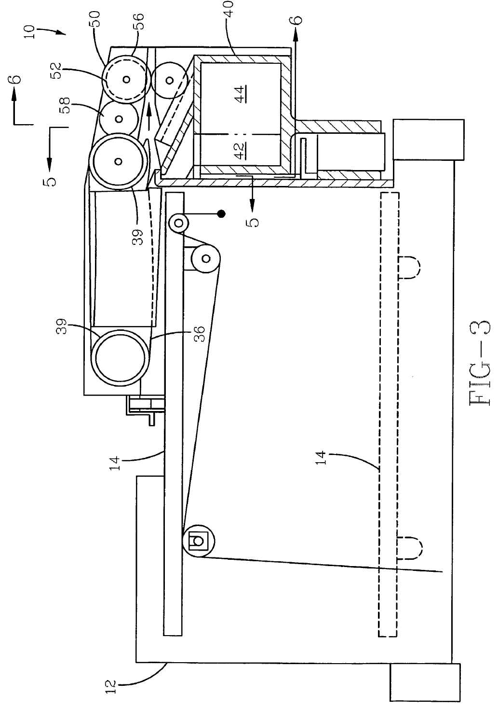
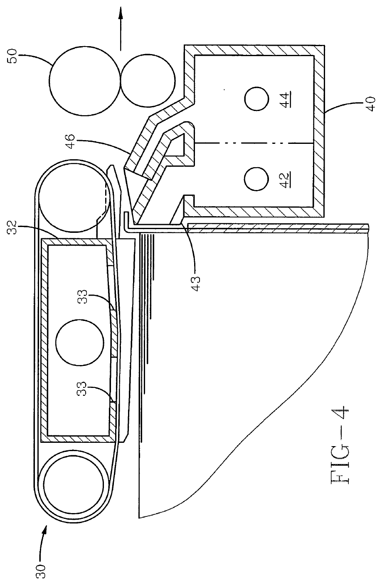

# Control for a pulsed air knife for a suction belt feed mechanism

A brief positive-pressure pulse separates the stack before the vacuum belt moves.

[EP1197450B1 · complete original PDF (12 pages)](../sources/EP1197450B1.pdf) · [Original PDF source](https://data.epo.org/publication-server/rest/v1.2/patents/EP1197450NWB1/document.pdf) · [Searchable publication](https://patents.google.com/patent/EP1197450B1/en) · [Espacenet](https://worldwide.espacenet.com/patent/search?q=pn%3DEP1197450B1)

## Original drawings

<figure>

<figcaption>Fig. 3. Section through the belt pickup and positive-pressure separator. <a href="../sources/EP1197450B1.pdf#page=9">EP1197450B1, PDF p. 9</a>.</figcaption>
</figure>
<figure>

<figcaption>Fig. 4. Detail of the corrugating feed head and adjacent air delivery. <a href="../sources/EP1197450B1.pdf#page=10">EP1197450B1, PDF p. 10</a>.</figcaption>
</figure>

## Publication

- **Publication** EP1197450B1
- **Inventors** Michael T. Dobbertin, Henry P. Mitchell, Jr.
- **Original assignee** Eastman Kodak Company
- **Priority** 2000-10-14 · **Filing** 2001-10-10 · **Publication** 2008-07-23
- **Application** Paper and document feeder
- **Mechanisms** Vacuum pickup, Air separation, Bending and peeling, Combined mechanisms

## What the patent describes

**Problem.** Airflow sufficient to acquire the top sheet could blow the rest of the stack backward or deflect light, downcurled sheets during feeding.

**Stack presentation.** A tray presents the top of the receiver stock below a vacuum corrugating belt head. The description also covers transparency sheets.

**Pickup sequence.** Open the vacuum and positive-pressure valves at the start of acquisition. The vacuum holds the raised, corrugated top sheet to the belt.

**Contact surfaces.** The perforated belt and corrugation element contact the selected sheet. Pressurized air acts near the exposed stock edge.

**Separation and overlap.** Close the positive-pressure valve before starting the belt clutch, while suction still holds the acquired sheet. End suction when the belt feed finishes. Some variants trigger controls from acquisition feedback.

**Handoff.** The belt moves the acquired sheet forward after the air pulse ends, allowing it to reach the outgoing transport path.

## Engineering interpretation

Air pressure and timing can be varied separately. A small pulse during an initial peel may be more stable than continuous airflow while a curled negative enters the nip.

**Media and length evidence.** The stated media and geometry establish the application on this page. Published pickup limits for loose, cut 35 mm strips remain unverified.

## Commercial evidence

The patent cites a vacuum belt feeder architecture. Production use of the claimed valve timing remains unverified.

## Related patents

[US4627605A · Front air knife top vacuum corrugation feeder](US4627605A.md) · [US4451028A · Sheet feeding apparatus](US4451028A.md) · [US20230202784A1 · Sheet feeder and image forming apparatus](US20230202784A1.md)

[Return to the pickup and separation archive](../index.md)
