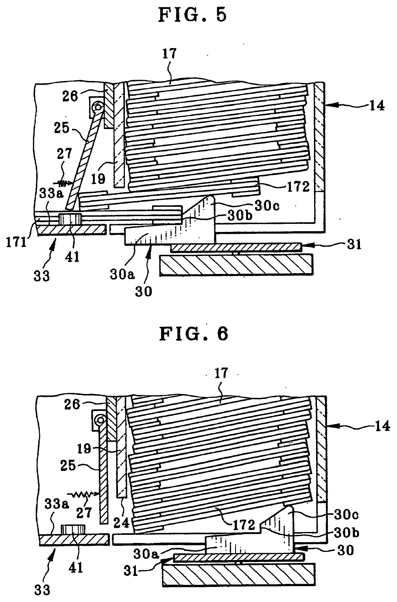
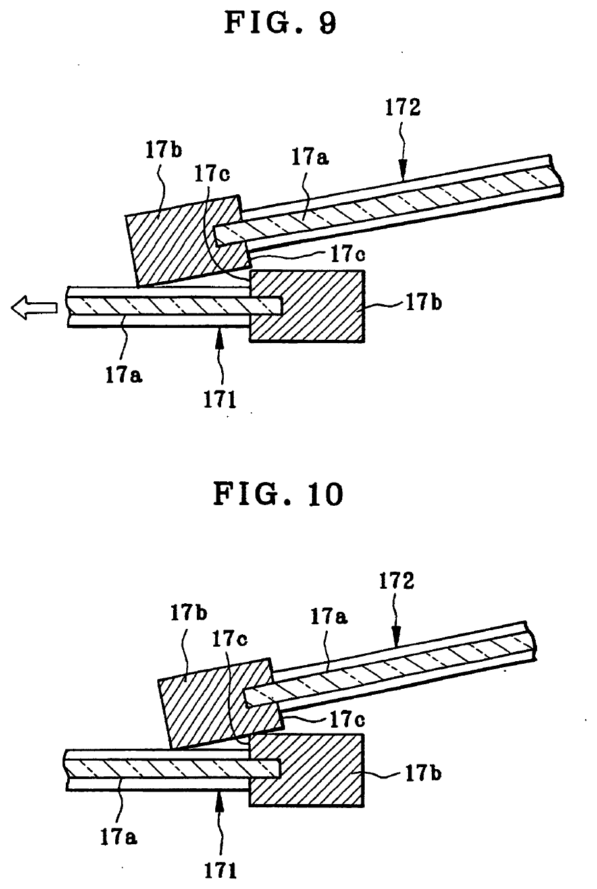

# Slide scanner with means for separating the slides from a stack

A cam-driven pusher feeds the lowest slide mount and a rising projection lifts the next mount out of its way.

[EP1267203B1 · complete original PDF (17 pages)](../sources/EP1267203B1.pdf) · [Original PDF source](https://data.epo.org/publication-server/rest/v1.2/patents/EP1267203NWB1/document.pdf) · [Searchable publication](https://patents.google.com/patent/EP1267203B1/en) · [Espacenet](https://worldwide.espacenet.com/patent/search?q=pn%3DEP1267203B1)

## Original drawings

<figure>

<figcaption>Figs. 5–6. Cam feed stroke and reset, with the projection above the pusher lifting the second mount. <a href="../sources/EP1267203B1.pdf#page=13">EP1267203B1, PDF p. 13</a>.</figcaption>
</figure>
<figure>

<figcaption>Figs. 9–10. Magnified comparison of the inner mount edges as one mount is separated from its neighbor. <a href="../sources/EP1267203B1.pdf#page=16">EP1267203B1, PDF p. 16</a>.</figcaption>
</figure>

## Publication

- **Publication** EP1267203B1
- **Inventors** Junichi Fuji Photo Film Co. Ltd. Tsuji
- **Original assignee** Fuji Photo Film Co Ltd
- **Priority** 2001-06-14 · **Filing** 2002-06-11 · **Publication** 2005-03-23
- **Application** Mounted-slide scanner
- **Mechanisms** Mechanical grip or pusher, Gate or edge selection, Combined mechanisms

## What the patent describes

**Problem.** The inner edge of a slide mount can hook the next mount as it is pushed from a cartridge. A warped or hooked mount can obstruct the feed or drag a second mount through.

**Stack presentation.** Mounts are stacked in a cartridge with bottom support ridges on the lateral edges, a lower access opening and a feed slot guarded by a spring-biased plate.

**Pickup sequence.** A cam reciprocates a stepped feeder whose forward shoulder engages the rear end of the lowest mount and drives it out of the feed slot.

**Contact surfaces.** The moving shoulder and its raised separator projection touch the slide mounts, while support ridges, the spring plate and feeder rollers contact the exposed mount boundaries and faces.

**Separation and overlap.** The projection lifts the second-lowest mount before their inner borders can interlock. The spring-biased plate restricts the slot as the feeder cycles. The path can include a recess to accommodate bent mounts during passage.

**Handoff.** The emerging mount enters roller pairs leading to the movable scan stage. A sensor in the feed path recognizes the leading edge of a mount or sorting card.

## Engineering interpretation

The useful analogue is actively moving the neighbor out of the departing strip's path rather than merely pushing harder. The lifting projection depends on rigid mount geometry. A bare 35 mm analogue would need a way to restrain or lift the next strip without entering the image area.

**Media and length evidence.** The stated media and geometry establish the application on this page. Published pickup limits for loose, cut 35 mm strips remain unverified.

## Commercial evidence

The publication describes a slide carrier and cartridge implementation. A production scanner using these exact numbered parts was not established.

## Related patents

[US2423404A · Plate dispenser for automatic photographic machines](US2423404A.md) · [US5555042A · Apparatus for automatically feeding slides into a film scanner](US5555042A.md) · [EP0521459A1 · Device for feeding single sheets out of a stack of film sheets](EP0521459A1.md)

[Return to the pickup and separation archive](../index.md)
