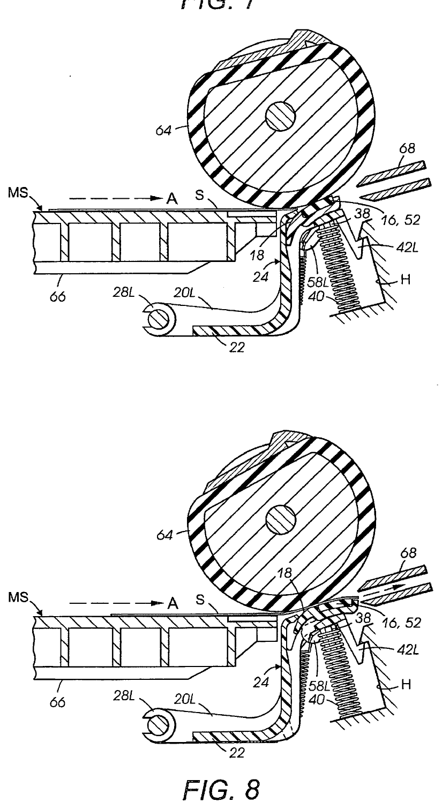
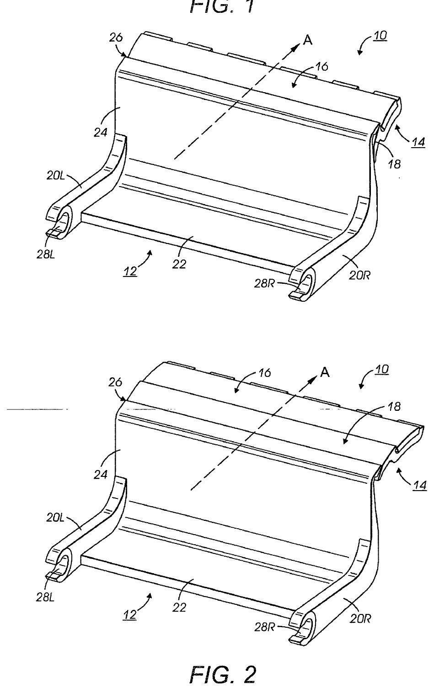

# Media separator mechanism

A spring-loaded sliding pad exposes a low-friction region once the leading medium has overcome the separation force.

[EP1721846B1 · complete original PDF (19 pages)](../sources/EP1721846B1.pdf) · [Original PDF source](https://data.epo.org/publication-server/rest/v1.2/patents/EP1721846NWB1/document.pdf) · [Searchable publication](https://patents.google.com/patent/EP1721846B1/en) · [Espacenet](https://worldwide.espacenet.com/patent/search?q=pn%3DEP1721846B1)

## Original drawings

<figure>

<figcaption>Figs. 7–8. D-shaped pick roller and two pad positions before and after the moving sheet exposes the second friction region. <a href="../sources/EP1721846B1.pdf#page=18">EP1721846B1, PDF p. 18</a>.</figcaption>
</figure>
<figure>

<figcaption>Figs. 1–2. Front views of the two friction regions and their changing exposure relative to the bracket. <a href="../sources/EP1721846B1.pdf#page=14">EP1721846B1, PDF p. 14</a>.</figcaption>
</figure>

## Publication

- **Publication** EP1721846B1
- **Inventors** Nathaniel D Ginzton
- **Original assignee** Xerox Corporation
- **Priority** 2005-05-13 · **Filing** 2006-05-08 · **Publication** 2010-12-22
- **Application** Paper and document feeder
- **Mechanisms** Friction pickup, Retard pad or roller, Combined mechanisms

## What the patent describes

**Problem.** A fixed pad's retarding force rises with nip force and is sensitive to media, wear and contamination. Different stock can narrow the overlap between a reliable grip and reliable separation.

**Stack presentation.** A tray presents the stack below a conventional feed element, illustrated as a D-shaped pick roller. The device addresses the separator downstream of the stack contact.

**Pickup sequence.** The roller frictionally drives the top sheet into the nip and toward the high-friction pad region initially exposed beyond a guide bracket.

**Contact surfaces.** The pick roller contacts one face and the pad and guide contact the opposite face. The pad has high- and lower-friction regions and slides in the feed direction against springs.

**Separation and overlap.** One sheet can pull the high-friction region forward, exposing the lower-friction region and allowing the sheet to bridge both. A follower sheet has only inter-sheet traction, which the spring-set retard force is intended to overcome.

**Handoff.** The selected sheet exits the nip along the guide. Once its trailing edge clears, the springs return the pad and can push a stalled second sheet back as far as the available slide travel.

## Engineering interpretation

The sliding pad is a precedent for making retention set by spring force rather than using a single material coefficient alone. That relationship depends on a valid friction window on each film face; measure worn and dusty conditions and check for face abrasion.

**Media and length evidence.** The stated media and geometry establish the application on this page. Published pickup limits for loose, cut 35 mm strips remain unverified.

## Commercial evidence

The described embodiment is a generic media handler. A commercial separator with this particular two-zone sliding pad has not been matched.

## Related patents

[US3469834A · Sheet feeder and separator apparatus](US3469834A.md) · [US3966189A · Toggling retard pad](US3966189A.md) · [EP0405466B1 · Single sheet picking and transport mechanism](EP0405466B1.md) · [US6932338B1 · Friction sheet feeding machine with reversible driven retard roller](US6932338B1.md)

[Return to the pickup and separation archive](../index.md)
