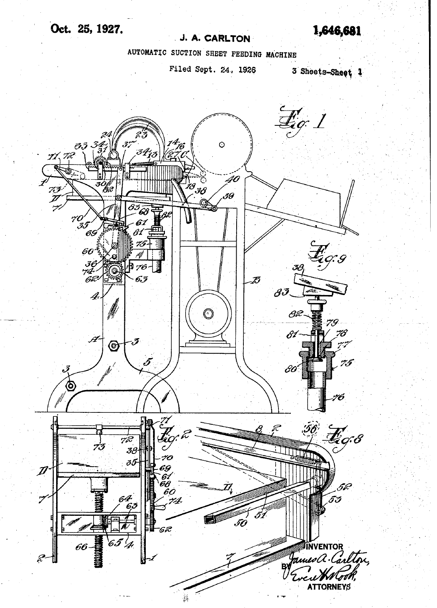
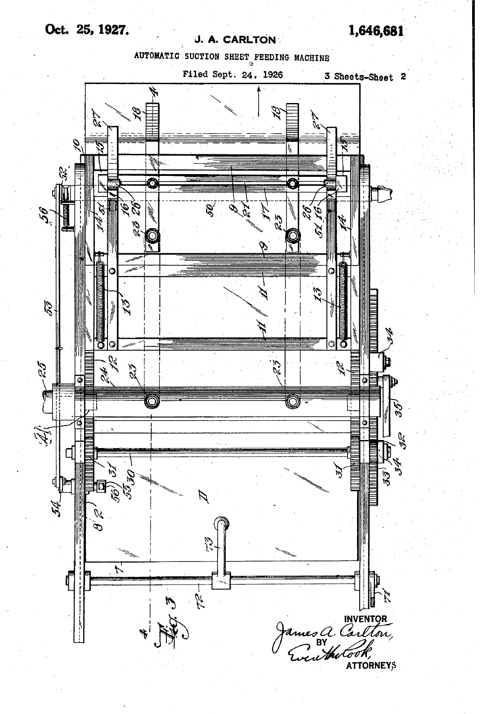

# Automatic suction sheet-feeding machine

A mechanically timed air manifold fluffs the stack just as a suction carriage approaches.

[US1646681A · complete original PDF (8 pages)](../sources/US1646681A.pdf) · [Original PDF source](https://patentimages.storage.googleapis.com/74/25/92/c97de2c728f215/US1646681.pdf) · [Searchable publication](https://patents.google.com/patent/US1646681A/en) · [Espacenet](https://worldwide.espacenet.com/patent/search?q=pn%3DUS1646681A)

## Original drawings

<figure>

<figcaption>Figs. 1-2 and 8-9. Side elevation of the paper stack, swinging mechanism and Multigraph handoff. <a href="../sources/US1646681A.pdf#page=1">US1646681A, PDF p. 1</a>.</figcaption>
</figure>
<figure>

<figcaption>Fig. 3. Cross-machine arrangement of the nozzles and two-part carriage. <a href="../sources/US1646681A.pdf#page=2">US1646681A, PDF p. 2</a>.</figcaption>
</figure>

## Publication

- **Publication** US1646681A
- **Inventors** James A Carlton
- **Original assignee** Charles S. Russell
- **Priority** 1926-09-24 · **Filing** 1926-09-24 · **Publication** 1927-10-25
- **Application** Paper and document feeder
- **Mechanisms** Vacuum pickup, Air separation, Combined mechanisms

## What the patent describes

**Problem.** The feeder automates feeding a printing machine while preventing two sheets from being lifted and adjusting for a falling stack surface.

**Stack presentation.** A vertically movable table holds a horizontal pile. A height-responsive pawl and screw raise it as sheets are removed.

**Pickup sequence.** Two carriage sections slide together and independently. Relative travel between them drives cams that lower and raise adjustable suction nozzles above the top sheet.

**Contact surfaces.** The moveable suction nozzles touch the upper face. The downstream paper rollers grip the delivered sheet.

**Separation and overlap.** A carriage-linked manifold turns its jets up toward the upper sheet edges during acquisition. It tips back down while the suction carriage carries the sheet away.

**Handoff.** The raised carriage moves toward the host machine's feed rollers. A cam-operated vent reduces suction after the rollers take the sheet.

## Engineering interpretation

Timing air delivery to the head position avoids blowing during the move to the nip. For short film, the usable edge gap and safe roller engagement distance must be measured independently of paper dimensions.

**Media and length evidence.** The stated media and geometry establish the application on this page. Published pickup limits for loose, cut 35 mm strips remain unverified.

## Commercial evidence

A Multigraph machine is the illustrated host. Production use of the pictured feeder remains unverified.

## Related patents

[US758453A · Pneumatic sheet-feeder.](US758453A.md) · [US4451028A · Sheet feeding apparatus](US4451028A.md) · [EP1197450B1 · Control for a pulsed air knife for a suction belt feed mechanism](EP1197450B1.md)

[Return to the pickup and separation archive](../index.md)
