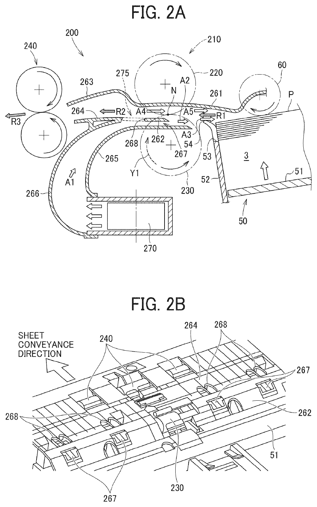
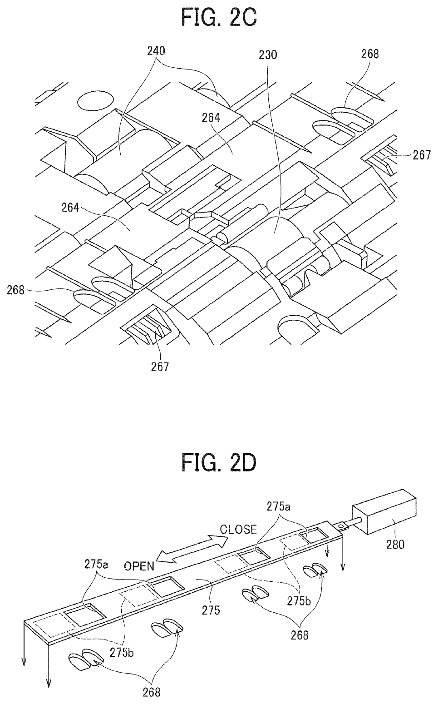
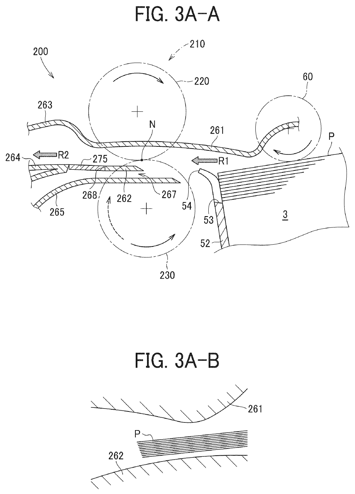

# Sheet feeder and image forming apparatus

Two groups of upstream-facing outlets separate overlapped sheets from the stack exit to the retard nip.

[US20230202784A1 · complete original PDF (18 pages)](../sources/US20230202784A1.pdf) · [Original PDF source](https://patentimages.storage.googleapis.com/46/b9/ba/0c5814900e5fdf/US20230202784A1.pdf) · [Searchable publication](https://patents.google.com/patent/US20230202784A1/en) · [Espacenet](https://worldwide.espacenet.com/patent/search?q=pn%3DUS20230202784A1)

## Original drawings

<figure>

<figcaption>Figs. 2A-2B. Cross-section and cover geometry at the roller nip and two air-outlet stages. <a href="../sources/US20230202784A1.pdf#page=4">US20230202784A1, PDF p. 4</a>.</figcaption>
</figure>
<figure>

<figcaption>Figs. 2C-2D. Plan and component views of the distributed outlet positions. <a href="../sources/US20230202784A1.pdf#page=5">US20230202784A1, PDF p. 5</a>.</figcaption>
</figure>
<figure>

<figcaption>Figs. 3A-A and 3A-B. Sheet path and front-edge airflow illustrated at the pickup and retard region. <a href="../sources/US20230202784A1.pdf#page=6">US20230202784A1, PDF p. 6</a>.</figcaption>
</figure>

## Publication

- **Publication** US20230202784A1
- **Inventors** Toshihiro OKUTSU, Junya Suzuki
- **Original assignee** Ricoh Co., Ltd.
- **Priority** 2021-12-24 · **Filing** 2022-10-31 · **Publication** 2023-06-29
- **Application** Paper and document feeder
- **Mechanisms** Air separation, Friction pickup, Retard pad or roller, Combined mechanisms

## What the patent describes

**Problem.** An air jet at the stack fence could stop reaching an overlapping leading edge once sheets passed the fence toward the nip.

**Stack presentation.** A feed tray and front fence register a bundle beneath a pickup roller.

**Pickup sequence.** The pickup roller advances the uppermost sheet toward a conveying roller and a torque-limited driven separation roller.

**Contact surfaces.** The pickup and upper conveyor rollers touch the sheet face. The lower separation roller can act on the underside of an overlapping sheet.

**Separation and overlap.** Air ports spaced at consecutive positions along the path blow back toward the stack and into overlapping edges. The lower roller supplies reverse retard torque when multiple sheets are in the nip.

**Handoff.** The separator nip passes one sheet to the downstream conveyor. The second set of outlets continues to act on leading edges near the nip.

## Engineering interpretation

Air applied immediately before a second grip can complement initial stack separation. On short negatives the gap, jet direction and rollout must limit flutter, buckling and reverse abrasion.

**Media and length evidence.** The stated media and geometry establish the application on this page. Published pickup limits for loose, cut 35 mm strips remain unverified.

## Commercial evidence

Use of the two-stage port geometry in a named Ricoh production model remains unverified.

## Related patents

[US4627605A · Front air knife top vacuum corrugation feeder](US4627605A.md) · [EP1197450B1 · Control for a pulsed air knife for a suction belt feed mechanism](EP1197450B1.md) · [US4451028A · Sheet feeding apparatus](US4451028A.md)

[Return to the pickup and separation archive](../index.md)
