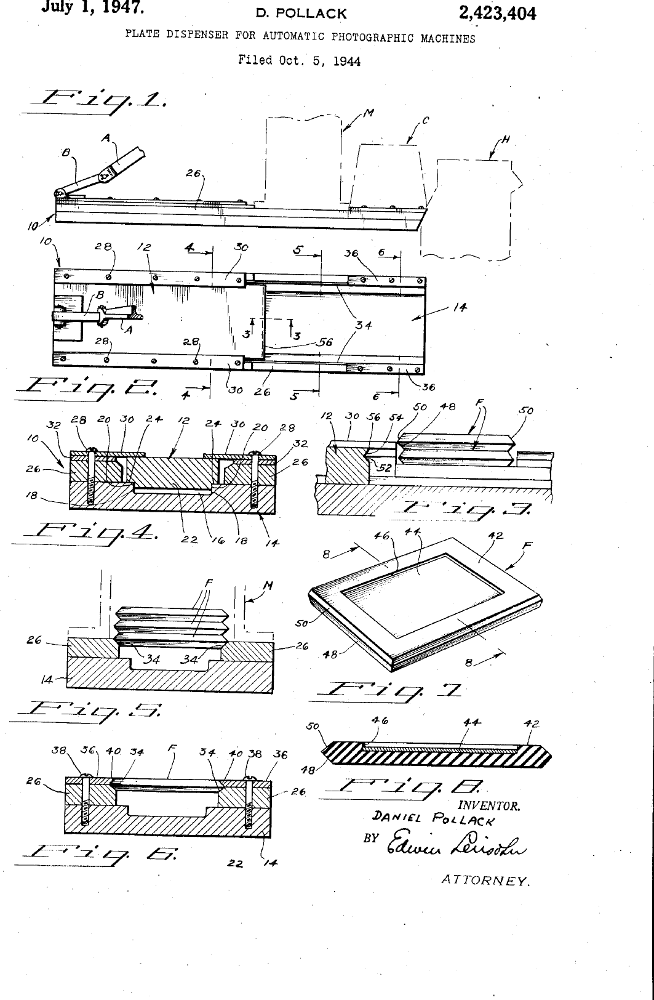

# Plate dispenser for automatic photographic machines

A stepped reciprocating slide removes the bottom framed plate while independent rails preserve the one-plate feed geometry.

[US2423404A · complete original PDF (4 pages)](../sources/US2423404A.pdf) · [Original PDF source](https://patentimages.storage.googleapis.com/15/8f/aa/8fe956bf4eeff5/US2423404.pdf) · [Searchable publication](https://patents.google.com/patent/US2423404A/en) · [Espacenet](https://worldwide.espacenet.com/patent/search?q=pn%3DUS2423404A)

## Original drawings

<figure>

<figcaption>Figs. 1–8. Magazine, camera and treatment chamber in sequence, with both guideways and the beveled frame plate shown in section. <a href="../sources/US2423404A.pdf#page=1">US2423404A, PDF p. 1</a>.</figcaption>
</figure>

## Publication

- **Publication** US2423404A
- **Inventors** Pollack Daniel
- **Original assignee** International Mutoscope Corp
- **Priority** 1944-10-05 · **Filing** 1944-10-05 · **Publication** 1947-07-01
- **Application** Automatic photographic machines
- **Mechanisms** Mechanical grip or pusher, Gate or edge selection, Combined mechanisms

## What the patent describes

**Problem.** When the earlier pusher and frame plates shared a guide, pusher wear could let the stack drop too far. The moving head could then catch an additional plate and jam.

**Stack presentation.** Framed photosensitive plates pile above the withdrawal rails with their sensitive surfaces facing upward. Beveled rail edges support and locate the bottom frame.

**Pickup sequence.** A reciprocating member under the magazine has an abutment that drives the bottom frame from its rear edge. It advances the next plate into the camera while a second projection can move the exposed frame onward.

**Contact surfaces.** The drive features contact frame edges and the independent rails and retaining straps contact matching bevels. The raised frame shields the sensitive plate.

**Separation and overlap.** The relative height of the pusher and plate paths exposes one frame to the withdrawal feature. Taking actuator wear out of the plate support path helps preserve that clearance.

**Handoff.** The first operation positions a plate at the camera. A subsequent stroke transports the exposed plate to the treating chamber along the same frame rails.

## Engineering interpretation

Splitting the wear-bearing actuator guide from the separable-item datum is transferable. A calibrated rigid frame edge is much easier to engage than a thin curved 35 mm film edge. A direct pusher would need compliance, safe edge engagement and a means to handle doubled or damaged film.

**Media and length evidence.** The stated media and geometry establish the application on this page. Published pickup limits for loose, cut 35 mm strips remain unverified.

## Commercial evidence

The patent names International Mutoscope and an earlier machine design in US2192755A. That supports the equipment family context. Use of this revised guideway in a specific booth is unverified.

## Related patents

[US735746A · Feeding device for magazine-cameras.](US735746A.md) · [EP1267203B1 · Slide scanner with means for separating the slides from a stack](EP1267203B1.md)

[Return to the pickup and separation archive](../index.md)
