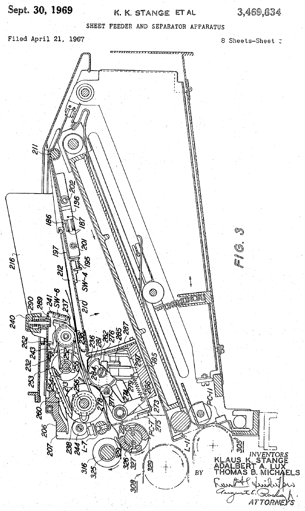
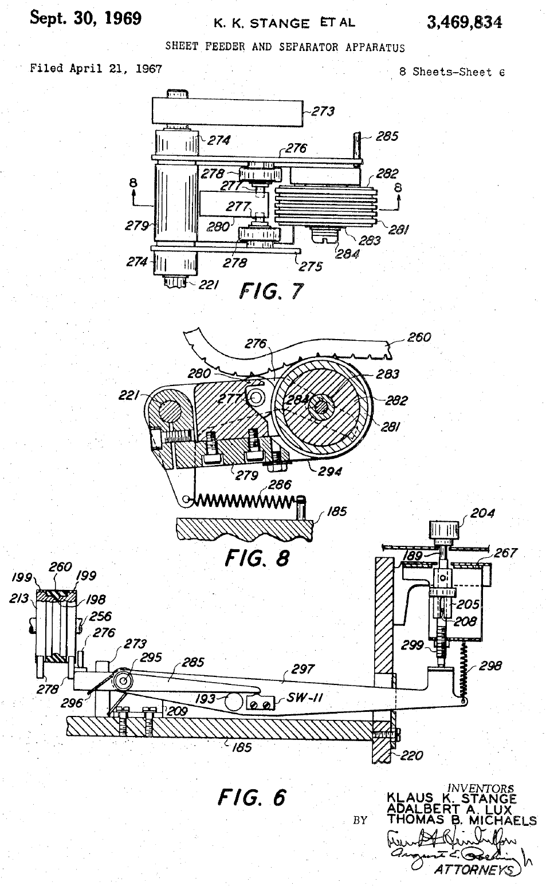

# Sheet feeder and separator apparatus

A slow nudger feeds a faster belt wrapped over a stationary curved retard roll.

[US3469834A · complete original PDF (18 pages)](../sources/US3469834A.pdf) · [Original PDF source](https://patentimages.storage.googleapis.com/a4/1b/46/99e8bfb206bc50/US3469834.pdf) · [Searchable publication](https://patents.google.com/patent/US3469834A/en) · [Espacenet](https://worldwide.espacenet.com/patent/search?q=pn%3DUS3469834A)

## Original drawings

<figure>

<figcaption>Fig. 3. Section through the document tray, nudger, belt separator and onward path. <a href="../sources/US3469834A.pdf#page=3">US3469834A, PDF p. 3</a>.</figcaption>
</figure>
<figure>

<figcaption>Figs. 6–8. Thickness sensing and the stationary retard member nested in the separator belt. <a href="../sources/US3469834A.pdf#page=6">US3469834A, PDF p. 6</a>.</figcaption>
</figure>

## Publication

- **Publication** US3469834A
- **Inventors** Klaus K Stange, Adalbert A Lux, Thomas B Michaels
- **Original assignee** Xerox Corporation
- **Priority** 1967-04-21 · **Filing** 1967-04-21 · **Publication** 1969-09-30
- **Application** Paper and document feeder
- **Mechanisms** Friction pickup, Retard pad or roller, Presence or double-feed detection, Combined mechanisms

## What the patent describes

**Problem.** A copier feeder must move one document from the stack even when adjacent sheets start out stuck together, while preserving reliable indexing and accommodating manual feed.

**Stack presentation.** Adjustable side guides square documents on a pivoted tray. A height-compensation arrangement raises the tray into contact with the nudger.

**Pickup sequence.** The nudger wheel moves the uppermost sheet toward the separator. Its design speed is lower than that of the advancing separator belt, limiting initial acceleration at the stack.

**Contact surfaces.** The nudger and moving belt contact sheet surfaces. A stationary curved friction roll presses into the belt, creating an extended separation area rather than a short point nip.

**Separation and overlap.** A bundle can enter the wrap as short overlaps. The stationary friction surface retards lower sheets while the driven belt advances the upper sheet to the exit. Separate thickness-sensitive idlers and a switch help detect excess material.

**Handoff.** The sheet proceeds from the tight exit of the wrap into registration and copier transport. A manual-feed linkage can retract the stationary retard member.

## Engineering interpretation

This is a worked example of decoupling stack pickup speed from throat separation speed. Wrapping a very short negative across a stationary friction surface would need explicit abrasion and minimum-grip-length tests.

**Media and length evidence.** The stated media and geometry establish the application on this page. Published pickup limits for loose, cut 35 mm strips remain unverified.

## Commercial evidence

The description shows a Xerox xerographic copier context. The patent does not establish a named production feeder using the precise mechanism.

## Related patents

[US3966189A · Toggling retard pad](US3966189A.md) · [EP1721846B1 · Media separator mechanism](EP1721846B1.md) · [US6932338B1 · Friction sheet feeding machine with reversible driven retard roller](US6932338B1.md)

[Return to the pickup and separation archive](../index.md)
