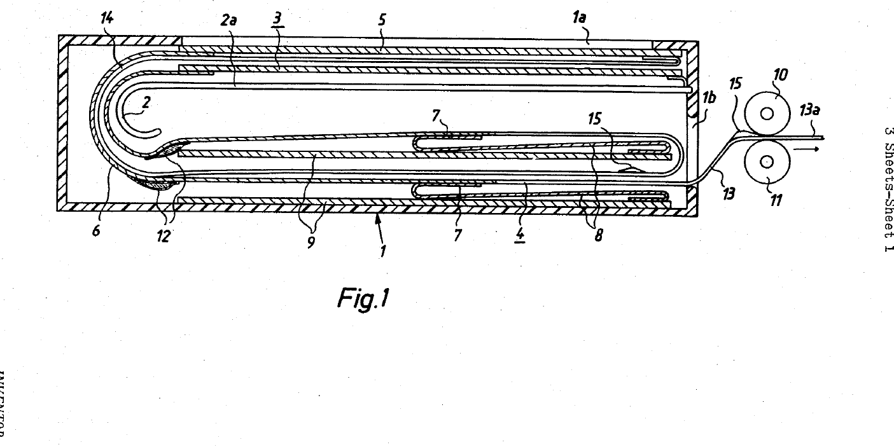
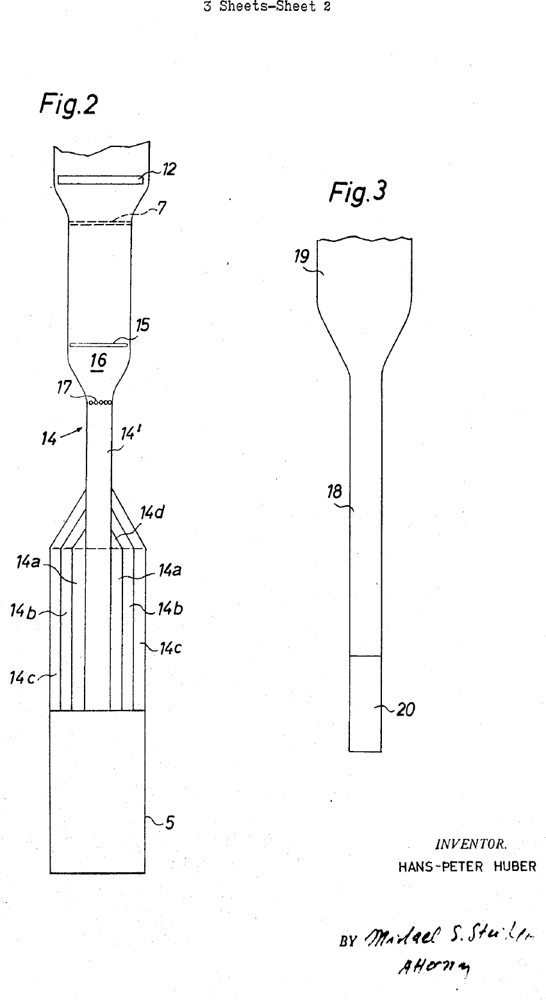

# Photographic film pack

Prepared leaders withdraw a photosensitive sheet and its matching receiving sheet, then stage the next leader.

[US3650751A · complete original PDF (8 pages)](../sources/US3650751A.pdf) · [Original PDF source](https://patentimages.storage.googleapis.com/ff/8a/02/b71798f9867235/US3650751.pdf) · [Searchable publication](https://patents.google.com/patent/US3650751A/en) · [Espacenet](https://worldwide.espacenet.com/patent/search?q=pn%3DUS3650751A)

## Original drawings

<figure>

<figcaption>Fig. 1. Section through paired stacks, leader routing and processing nip. <a href="../sources/US3650751A.pdf#page=2">US3650751A, PDF p. 2</a>.</figcaption>
</figure>
<figure>

<figcaption>Figs. 2–3. Developed strip and leader used to stage successive film units. <a href="../sources/US3650751A.pdf#page=3">US3650751A, PDF p. 3</a>.</figcaption>
</figure>

## Publication

- **Publication** US3650751A
- **Inventors** Hans-Peter Huber
- **Original assignee** Agfa-Gevaert AG
- **Priority** 1967-12-22 · **Filing** 1968-12-19 · **Publication** 1972-03-21
- **Application** Photographic film packs
- **Mechanisms** Bending and peeling, Mechanical grip or pusher, Combined mechanisms

## What the patent describes

**Problem.** A self-processing camera film pack needed to join and withdraw one photosensitive/receiving-sheet pair through processing rollers after each exposure.

**Stack presentation.** The pack contains separate stacks of photosensitive and print-receiving sheets. A pressure plate moves the active photosensitive surface to the exposure plane.

**Pickup sequence.** The operator pulls the protruding leader. Flexible connecting strips draw the outermost sheet from each compartment toward their shared exit.

**Contact surfaces.** The withdrawal force acts through preattached strips. The paired sheets travel into the processing nip, where the rollers squeeze the pair as it leaves.

**Separation and overlap.** The connectors have a prescribed fold and routing. Pulling the active leader draws the intended sheet pair and stages the next leader by way of a coupling strip and breakaway connection. The pair is intentional.

**Handoff.** The two sheets meet in register and pass through rollers 10 and 11. The next leader remains in a position to be gripped for the following exposure.

## Engineering interpretation

The connector and pull-tab geometry makes selection and handoff repeatable. It presumes specially assembled consumables. For loose film, look at the logic of engaging the next receiver before release, while treating the leader itself as a separate design.

**Media and length evidence.** The useful connector lengths are defined relative to the matching sheets in the pack. The specification gives no validated unmounted 35 mm strip range.

## Commercial evidence

The assignee and film-pack process are documented in the patent. A branded pack that can be matched to this particular leader geometry was not verified.

## Related patents

[US571470A · Pack of photographic films](US571470A.md) · [US735746A · Feeding device for magazine-cameras.](US735746A.md) · [US6556276B2 · Photographic reorder system and method](US6556276B2.md)

[Return to the pickup and separation archive](../index.md)
