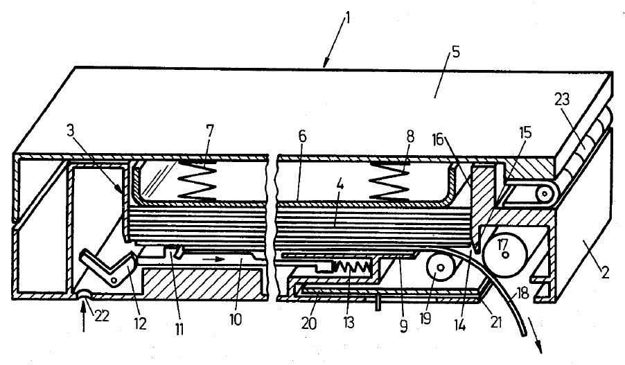

# Arrangement for respectively withdrawing a single film sheet from a stack of directly loosely superimposed film sheets

An edge claw pushes the bottom film sheet into a sloped lip so its leading edge bends away from the stack.

[US3955092A · complete original PDF (4 pages)](../sources/US3955092A.pdf) · [Original PDF source](https://patentimages.storage.googleapis.com/ba/da/6f/3fa8a54e3ce6d3/US3955092.pdf) · [Searchable publication](https://patents.google.com/patent/US3955092A/en) · [Espacenet](https://worldwide.espacenet.com/patent/search?q=pn%3DUS3955092A)

## Original drawings

<figure>

<figcaption>Single figure. Cassette section showing the floor pusher, angled exit wall and rolls. <a href="../sources/US3955092A.pdf#page=2">US3955092A, PDF p. 2</a>.</figcaption>
</figure>

## Publication

- **Publication** US3955092A
- **Inventors** Gunter Hubert
- **Original assignee** Siemens AG
- **Priority** 1973-10-13 · **Filing** 1974-10-09 · **Publication** 1976-05-04
- **Application** Radiographic sheet film
- **Mechanisms** Mechanical grip or pusher, Bending and peeling, Gate or edge selection, Combined mechanisms

## What the patent describes

**Problem.** A light-tight X-ray cassette needed to withdraw individual loosely superimposed film sheets, with limited surface rubbing and dependence on a vacuum seal.

**Stack presentation.** A sprung pressure plate holds the film stack against the cassette floor. A slot along the full discharge edge opens when the cassette is docked.

**Pickup sequence.** A sliding pusher catches the rear edge of the bottom sheet with a claw about eight-tenths of one sheet thickness high. The patent also describes driving a floor roller instead of the claw.

**Contact surfaces.** The claw contacts the trailing cut edge. The leading edge meets a sloped wall and then runs over two rolls to leave the cassette.

**Separation and overlap.** The pushed sheet bends at the wall. The specification attributes separation to that curvature and the lower force transferred to the sheet above. The rolls limit sliding on the slot edges.

**Handoff.** The selected sheet runs around the rolls through the slot far enough for the host apparatus to engage it. The pusher returns and the stack re-seats.

## Engineering interpretation

The design controls adhesion by opening a peel gap while pushing at the edge. Edge damage, variable thickness and lengthwise curl can keep a short cut strip from seating against a thin claw. A single-frame test must include imperfect ends and deliberately skewed stock.

**Media and length evidence.** The geometry is specified for cassette sheet film. Claw height is relative to film thickness and the slot extends across the cassette. No validated cut-strip range is reported.

## Commercial evidence

The patent identifies an X-ray cassette application. An independently documented commercial cassette with the illustrated claw and rolls was not found.

## Related patents

[US4365793A · Sheet film feeder](US4365793A.md) · [EP0521459A1 · Device for feeding single sheets out of a stack of film sheets](EP0521459A1.md) · [US4179114A · Film sheet handling device](US4179114A.md)

[Return to the pickup and separation archive](../index.md)
