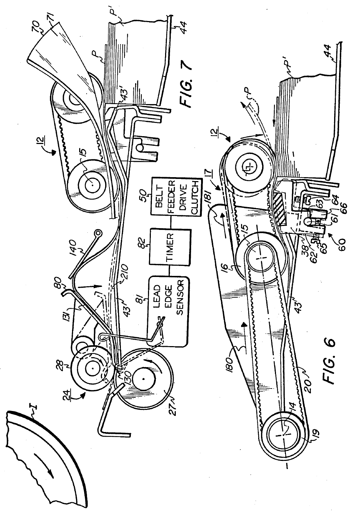
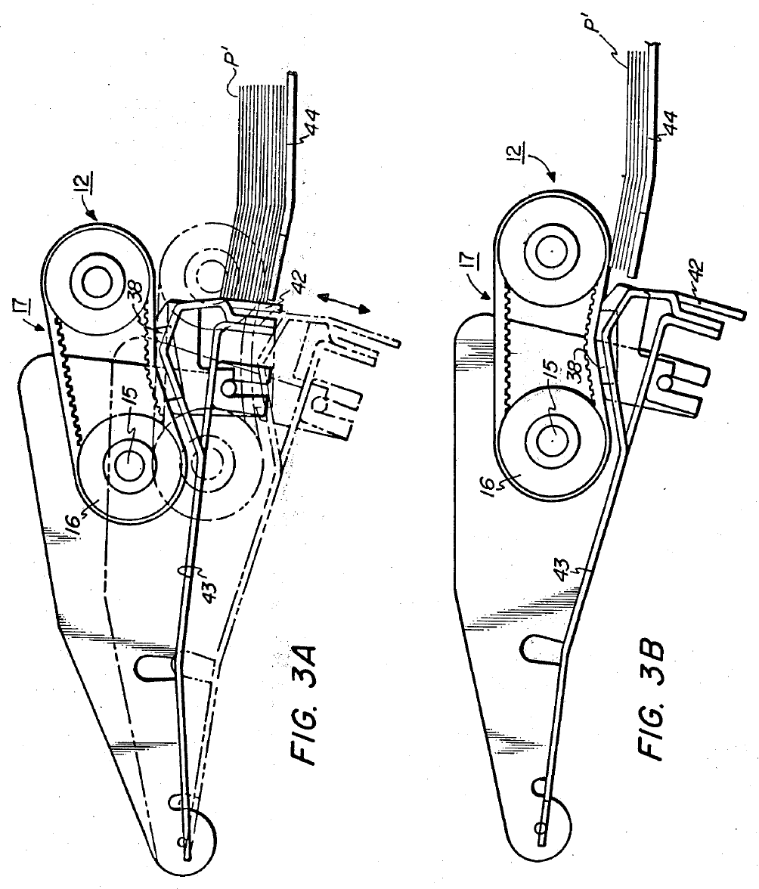

# Toggling retard pad

Forward drag tightens the retard pad, while reverse withdrawal makes the same pad release.

[US3966189A · complete original PDF (22 pages)](../sources/US3966189A.pdf) · [Original PDF source](https://patentimages.storage.googleapis.com/e5/35/66/a026c9019e2be6/US3966189.pdf) · [Searchable publication](https://patents.google.com/patent/US3966189A/en) · [Espacenet](https://worldwide.espacenet.com/patent/search?q=pn%3DUS3966189A)

## Original drawings

<figure>

<figcaption>Figs. 6–7. Belt and retard-pad geometry, including the offset toggle pivot and downstream registration. <a href="../sources/US3966189A.pdf#page=7">US3966189A, PDF p. 7</a>.</figcaption>
</figure>
<figure>

<figcaption>Figs. 3A–3B. Separator and baffle at the tray during loading and feeding. <a href="../sources/US3966189A.pdf#page=4">US3966189A, PDF p. 4</a>.</figcaption>
</figure>

## Publication

- **Publication** US3966189A
- **Inventors** Thomas N. Taylor, Wayne F. Schoppe
- **Original assignee** Xerox Corporation
- **Priority** 1974-09-05 · **Filing** 1974-09-05 · **Publication** 1976-06-29
- **Application** Paper and document feeder
- **Mechanisms** Friction pickup, Retard pad or roller, Combined mechanisms

## What the patent describes

**Problem.** Sheets left shingled in a conventional retard nip resist removal when a stack is changed. Manual release hardware can be difficult to reach in a compact copier.

**Stack presentation.** The described top-feed embodiment supports a stack in an extendable tray, with a loading baffle and a pivoted belt feeder. An alternate bottom-feed arrangement is also shown.

**Pickup sequence.** The feed belt frictionally nudges the top sheet into the curved retard throat. Opposed surfaces can stage several leading edges at different positions.

**Contact surfaces.** The belt contacts one face and the retard pad contacts the opposite face. An offset pivot places the pad support downstream of the pad centerline.

**Separation and overlap.** Forward sheet drag pivots the pad toward the unsupported belt span, increasing belt deflection and nip force. Reverse withdrawal pivots the pad away, lowering the force. An adjustable stop limits forward toggle movement.

**Handoff.** The top sheet advances from the retard throat to the downstream registration rolls. If the operator draws staged sheets back, the nip loosens under that motion.

## Engineering interpretation

Direction-sensitive load can support controlled jam clearing without an extra actuator. A tacky pad could still mark a negative and catching a bent single frame depends on grip before and after the throat.

**Media and length evidence.** The stated media and geometry establish the application on this page. Published pickup limits for loose, cut 35 mm strips remain unverified.

## Commercial evidence

The patent names Xerox and gives copier embodiments. No individual production feeder was matched to the design.

## Related patents

[US3469834A · Sheet feeder and separator apparatus](US3469834A.md) · [EP1721846B1 · Media separator mechanism](EP1721846B1.md) · [US6932338B1 · Friction sheet feeding machine with reversible driven retard roller](US6932338B1.md)

[Return to the pickup and separation archive](../index.md)
