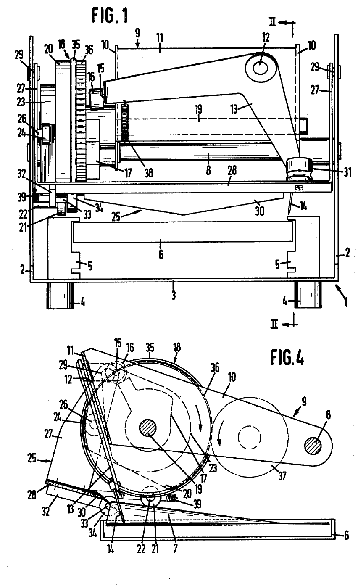
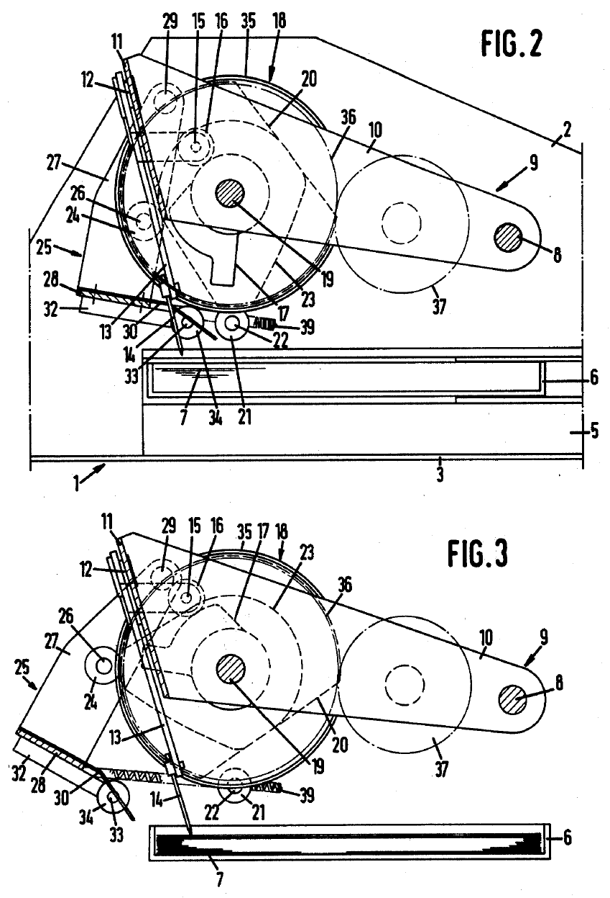

# Film sheet handling device

A pin engages the top-film margin and bows the outermost sheet so a guide can capture it.

[US4179114A · complete original PDF (6 pages)](../sources/US4179114A.pdf) · [Original PDF source](https://patentimages.storage.googleapis.com/7b/02/41/1eeb773c294d19/US4179114.pdf) · [Searchable publication](https://patents.google.com/patent/US4179114A/en) · [Espacenet](https://worldwide.espacenet.com/patent/search?q=pn%3DUS4179114A)

## Original drawings

<figure>

<figcaption>Figs. 1 and 4. Device from the delivery end and the stage after the selected sheet has bowed over the inserted guide. <a href="../sources/US4179114A.pdf#page=2">US4179114A, PDF p. 2</a>.</figcaption>
</figure>
<figure>

<figcaption>Figs. 2–3. Cross sections in the initial position and with the pin approaching or engaging the film margin. <a href="../sources/US4179114A.pdf#page=3">US4179114A, PDF p. 3</a>.</figcaption>
</figure>

## Publication

- **Publication** US4179114A
- **Inventors** Lucas van der Does
- **Original assignee** Optische Industrie de Oude Delft NV
- **Priority** 1976-12-20 · **Filing** 1977-12-15 · **Publication** 1979-12-18
- **Application** Photographic sheet film
- **Mechanisms** Mechanical grip or pusher, Bending and peeling, Combined mechanisms

## What the patent describes

**Problem.** A prior blade had to align with the exact height of one film edge. Misadjustment could miss the sheet or bow two sheets at once.

**Stack presentation.** A film cassette presents a stack with its uppermost sheet accessible through the open top at the delivery end.

**Pickup sequence.** A cam-controlled lever lowers a pin onto the top sheet. A further movement approximately in the sheet plane shifts the contacting margin so the top sheet bows.

**Contact surfaces.** The preferred embodiment presses the pointed pin slightly into a marginal area at an acute angle. A guide lifts into the gap and discharge rollers grip the separated sheet.

**Separation and overlap.** The pin selects the exposed face rather than relying on an exact thickness step. The temporary bow creates clearance for the supporting guide. The cam disengages the pin after the guide is under the raised sheet.

**Handoff.** The shaped guide directs the raised sheet into the driven discharge roller and opposing roller. The shared cam mechanism sequences pinch, guide and withdrawal.

## Engineering interpretation

A deliberately created gap can make a clean handoff more reliable under height variation. The pointed contact is a clear damage risk for archival negatives, especially a loose frame with almost no margin. Only the lift-before-handoff principle transfers directly.

**Media and length evidence.** The stated media and geometry establish the application on this page. Published pickup limits for loose, cut 35 mm strips remain unverified.

## Commercial evidence

The specification describes a cassette film-sheet device. Commercial use of its pin assembly is unverified.

## Related patents

[EP0521459A1 · Device for feeding single sheets out of a stack of film sheets](EP0521459A1.md) · [US6556276B2 · Photographic reorder system and method](US6556276B2.md)

[Return to the pickup and separation archive](../index.md)
