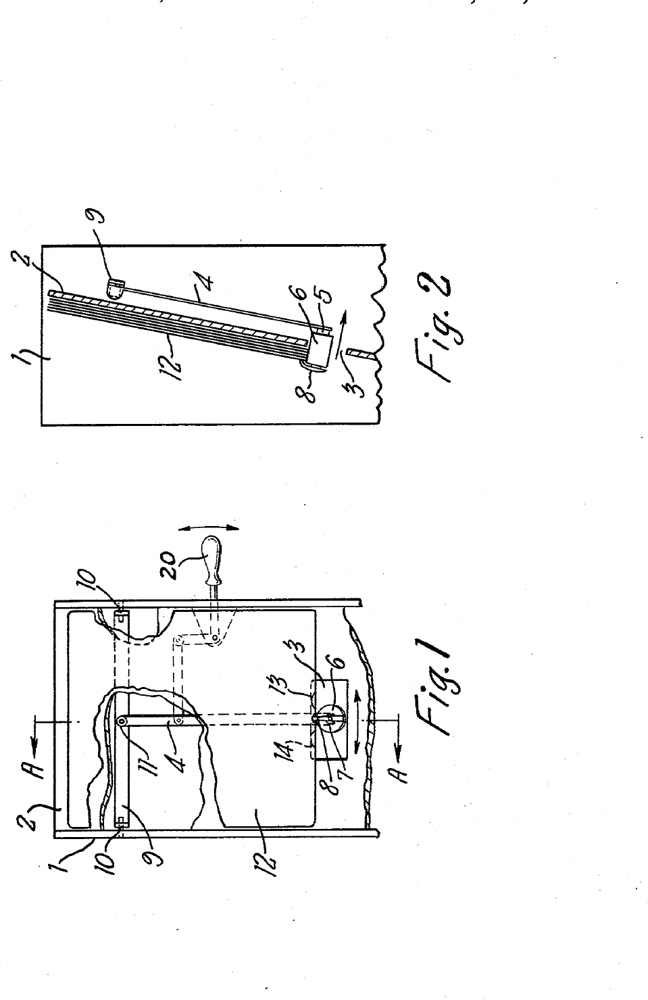
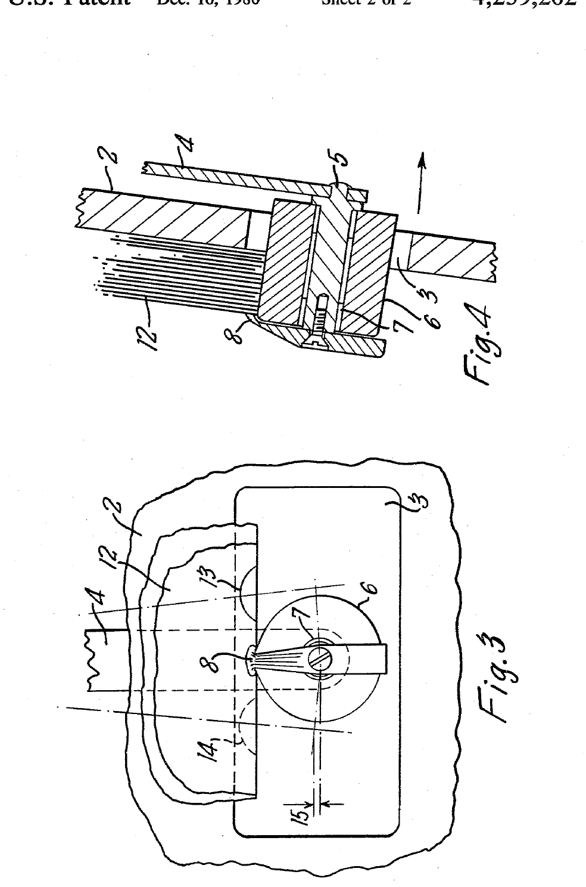

# Sheet dispenser

A traversing pendulum releases notched X-ray sheets by peeling the outer sheet away into a gravity drop.

[US4239202A · complete original PDF (5 pages)](../sources/US4239202A.pdf) · [Original PDF source](https://patentimages.storage.googleapis.com/d6/25/10/d62785d9715bad/US4239202.pdf) · [Searchable publication](https://patents.google.com/patent/US4239202A/en) · [Espacenet](https://worldwide.espacenet.com/patent/search?q=pn%3DUS4239202A)

## Original drawings

<figure>

<figcaption>Figs. 1-2. Cassette sections showing the near-vertical stack and alternating notch positions. <a href="../sources/US4239202A.pdf#page=2">US4239202A, PDF p. 2</a>.</figcaption>
</figure>
<figure>

<figcaption>Figs. 3-4. Enlarged views of the roller and pendulum plough. <a href="../sources/US4239202A.pdf#page=3">US4239202A, PDF p. 3</a>.</figcaption>
</figure>

## Publication

- **Publication** US4239202A
- **Inventors** George F. A. M. Turner
- **Original assignee** Ciba Geigy AG
- **Priority** 1977-03-23 · **Filing** 1978-03-16 · **Publication** 1980-12-16
- **Application** Film cassette handling
- **Mechanisms** Bending and peeling, Mechanical grip or pusher, Gate or edge selection

## What the patent describes

**Problem.** Sheets of radiographic film without interleaving paper are difficult to separate without scratching or bending them.

**Stack presentation.** The stack sits close to vertical in a sloping holder. Alternate sheets have edge notches on opposite sides, and a roller supports the front of the stack.

**Pickup sequence.** A pendulum traverses the sheet width and tips in the stack-thickness direction. Its plough aligns with the notch of the exposed sheet and enters below it.

**Contact surfaces.** The support roller meets the forward face. The plough acts locally at a prepared sheet edge.

**Separation and overlap.** The moving plough wedges under the outer sheet. The next sheet's notch lies at the other position, so the plough meets it on the return stroke.

**Handoff.** The peeled sheet drops by gravity. The pendulum stays in contact with the next sheet before reversing traversal.

## Engineering interpretation

The machine derives selection from a feature on the sheet. Ordinary negatives lack staggered notches. Any comparable edge-based approach must tolerate irregular cuts without marking image areas.

**Media and length evidence.** The stated media and geometry establish the application on this page. Published pickup limits for loose, cut 35 mm strips remain unverified.

## Commercial evidence

The drawings establish a dispenser for a specially notched film stack. A named production model and compatible film stock remain unverified.

## Related patents

[US4979729A · Suction device for removing film sheets](US4979729A.md) · [EP0512084B1 · Sheet-film removal device](EP0512084B1.md) · [US758453A · Pneumatic sheet-feeder.](US758453A.md)

[Return to the pickup and separation archive](../index.md)
