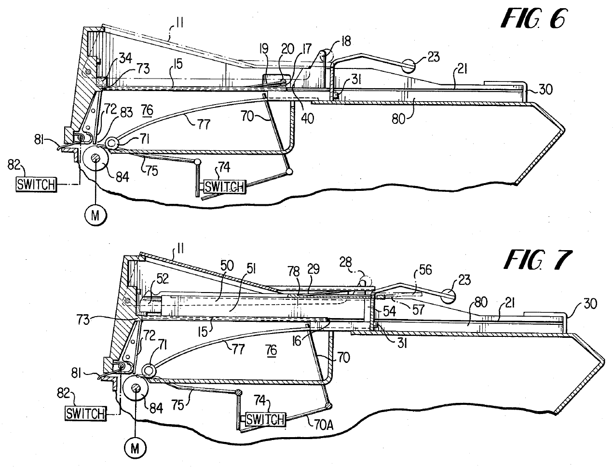
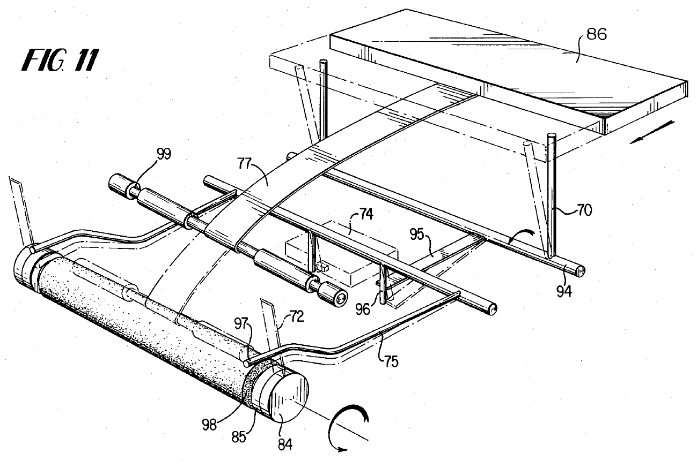

# Sheet film feeder

A powered rubber roller pulls one exposed sheet under a thickness-setting blade into a synchronized processor.

[US4365793A · complete original PDF (13 pages)](../sources/US4365793A.pdf) · [Original PDF source](https://patentimages.storage.googleapis.com/01/14/63/3ba7f759016688/US4365793.pdf) · [Searchable publication](https://patents.google.com/patent/US4365793A/en) · [Espacenet](https://worldwide.espacenet.com/patent/search?q=pn%3DUS4365793A)

## Original drawings

<figure>

<figcaption>Figs. 6–7. Cross-sections of the empty receiver and docked take-up magazine. <a href="../sources/US4365793A.pdf#page=4">US4365793A, PDF p. 4</a>.</figcaption>
</figure>
<figure>

<figcaption>Fig. 11. Transport assembly at the exit toward the adjacent processor. <a href="../sources/US4365793A.pdf#page=7">US4365793A, PDF p. 7</a>.</figcaption>
</figure>

## Publication

- **Publication** US4365793A
- **Inventors** Gerardus J. Van Blokland, Henry J. Bailey
- **Original assignee** OLDELFT CORP OF AMERICA
- **Priority** 1979-11-06 · **Filing** 1979-11-06 · **Publication** 1982-12-28
- **Application** Radiographic sheet film
- **Mechanisms** Friction pickup, Gate or edge selection, Presence or double-feed detection, Combined mechanisms

## What the patent describes

**Problem.** An X-ray film system needed to unload exposed 100 × 100 mm sheets from a take-up magazine in daylight and feed them singly to a processor.

**Stack presentation.** Opening a light-tight darkslide lets a magazine deposit its entire stack in a separate cavity. A stacking bar and pressure rollers align the sheets and press them toward the discharge area.

**Pickup sequence.** A powered, belt-driven rubber roller at the cavity floor advances the bottom sheet.

**Contact surfaces.** Driving friction acts on the sheet face at the rubber roller. Pressure rollers, the calibrated blade and the discharge closure also constrain its path.

**Separation and overlap.** A blade sets the opening above the roller to about a single sheet thickness. Switches track availability at the cavity and passage at the exit; the blade supplies the selective mechanical restriction.

**Handoff.** The rubber roller pushes the sheet past the light-tight closure. The feeder and adjacent processor synchronize through an electrical connection.

## Engineering interpretation

A stable, pre-sized film demonstrates a simple calibrated-throat approach. A curled or jagged short negative could hit the blade and scrape, catch or buckle. Measure the incoming edge angle as well as film thickness and set downstream grip within the remaining length.

**Media and length evidence.** The disclosed X-ray camera stock is 100 × 100 mm. The source gives no trial evidence for 35 mm-wide cut pieces.

## Commercial evidence

The patent refers to an earlier magazine system in US3627307A. An independently identified processor or feeder showing the disclosed blade was not verified.

## Related patents

[US3955092A · Arrangement for respectively withdrawing a single film sheet from a stack of directly loosely superimposed film sheets](US3955092A.md) · [EP0521459A1 · Device for feeding single sheets out of a stack of film sheets](EP0521459A1.md) · [US7654522B2 · Sheet feeder with ultrasonic double feed detector](US7654522B2.md)

[Return to the pickup and separation archive](../index.md)
