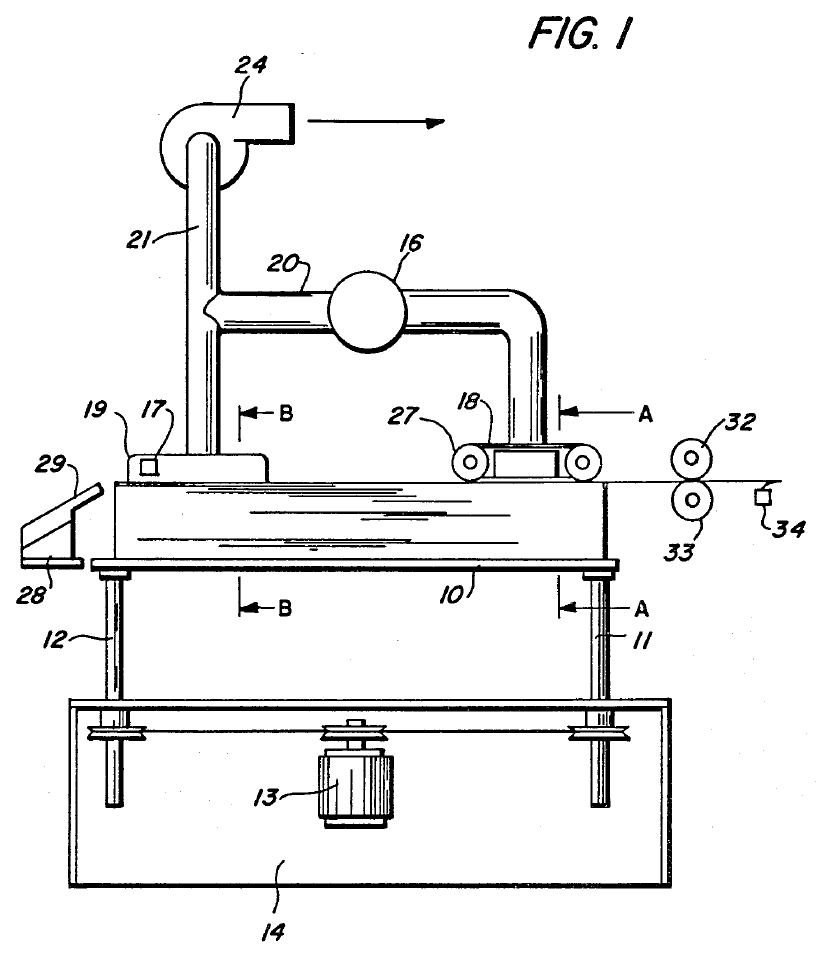
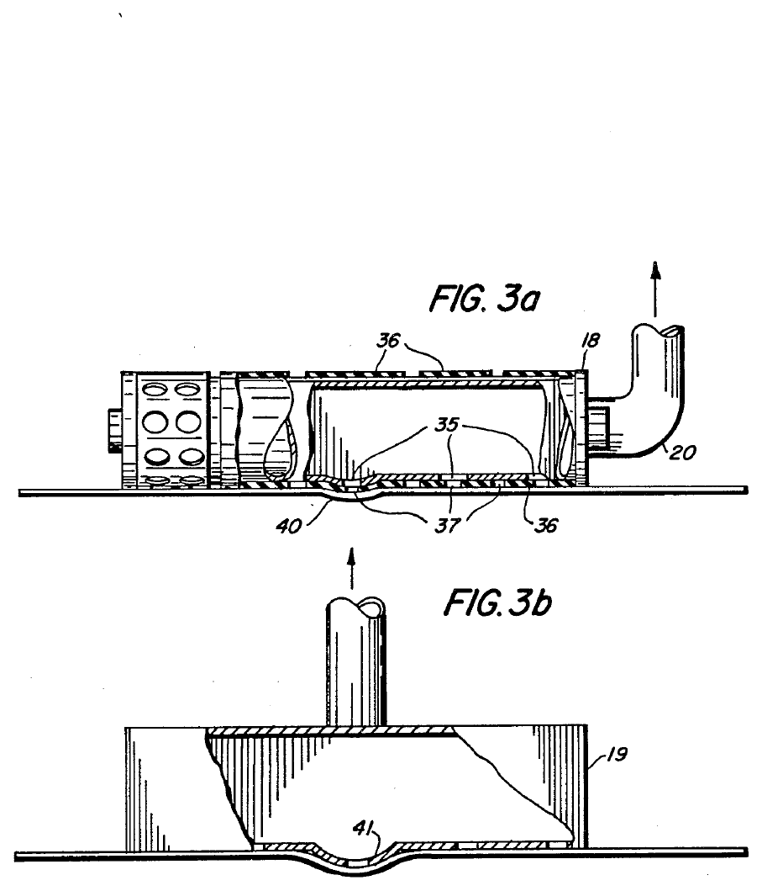
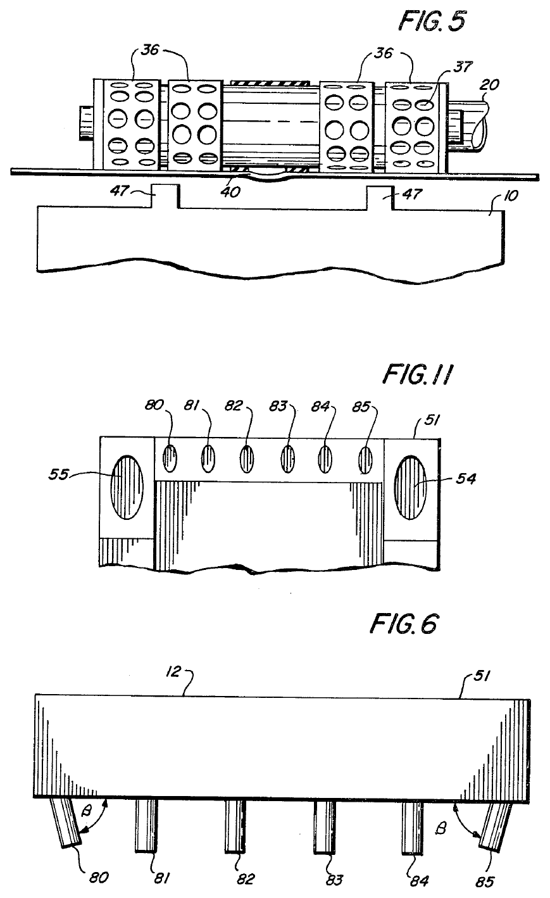

# Sheet feeding apparatus

A rear air knife and pickup plenum prepare each trailing edge while a separate front plenum drives off the preceding sheet.

[US4451028A · complete original PDF (14 pages)](../sources/US4451028A.pdf) · [Original PDF source](https://patentimages.storage.googleapis.com/94/47/0d/6c38a57a02b7d0/US4451028.pdf) · [Searchable publication](https://patents.google.com/patent/US4451028A/en) · [Espacenet](https://worldwide.espacenet.com/patent/search?q=pn%3DUS4451028A)

## Original drawings

<figure>

<figcaption>Fig. 1. Section showing the rear air knife, rear vacuum plenum and front belt head. <a href="../sources/US4451028A.pdf#page=2">US4451028A, PDF p. 2</a>.</figcaption>
</figure>
<figure>

<figcaption>Figs. 3A-3B. Sections through the respective corrugating members. <a href="../sources/US4451028A.pdf#page=4">US4451028A, PDF p. 4</a>.</figcaption>
</figure>
<figure>

<figcaption>Figs. 5-6 and 11. View of the belt transport and layouts of the converging rear air knife. <a href="../sources/US4451028A.pdf#page=6">US4451028A, PDF p. 6</a>.</figcaption>
</figure>

## Publication

- **Publication** US4451028A
- **Inventors** Maurice F. Holmes, Gerald M. Garavuso
- **Original assignee** Xerox Corporation
- **Priority** 1981-11-27 · **Filing** 1981-11-27 · **Publication** 1984-05-29
- **Application** Paper and document feeder
- **Mechanisms** Vacuum pickup, Air separation, Bending and peeling, Combined mechanisms

## What the patent describes

**Problem.** The feeder seeks high throughput by overlapping sheet acquisition and transport while limiting multifeeds.

**Stack presentation.** A tray and its support geometry present the top of a horizontal stack to front and rear plenums above it.

**Pickup sequence.** Rear airflow fluffs the top few sheets and rear vacuum lifts the trailing edge. Front vacuum then draws the same sheet to perforated transport belts.

**Contact surfaces.** Rear and front corrugating surfaces contact the sheet from above. The front belts grip its upper face.

**Separation and overlap.** Lateral converging air streams and center corrugation admit air under the selected sheet. The rear vacuum can acquire the next trailing edge once the moving sheet clears it.

**Handoff.** The front perforated belts continue moving the selected sheet forward on the outgoing path. The rear edge acquisition then starts again.

## Engineering interpretation

Separating acquisition and output permits an overlapping cycle. In a loose-strip feeder, the spacing between front and rear grip must fit both ends of the shortest strip, and the air must avoid moving adjacent curled pieces.

**Media and length evidence.** The stated media and geometry establish the application on this page. Published pickup limits for loose, cut 35 mm strips remain unverified.

## Commercial evidence

The patent illustrates a paper feed architecture. Production adoption of the particular rear and front plenum arrangement remains unverified.

## Related patents

[US1646681A · Automatic suction sheet-feeding machine](US1646681A.md) · [US4627605A · Front air knife top vacuum corrugation feeder](US4627605A.md) · [EP1197450B1 · Control for a pulsed air knife for a suction belt feed mechanism](EP1197450B1.md)

[Return to the pickup and separation archive](../index.md)
