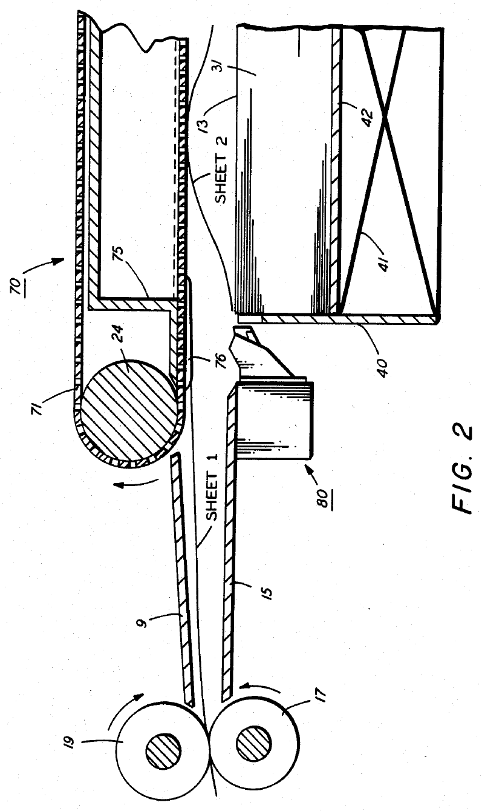
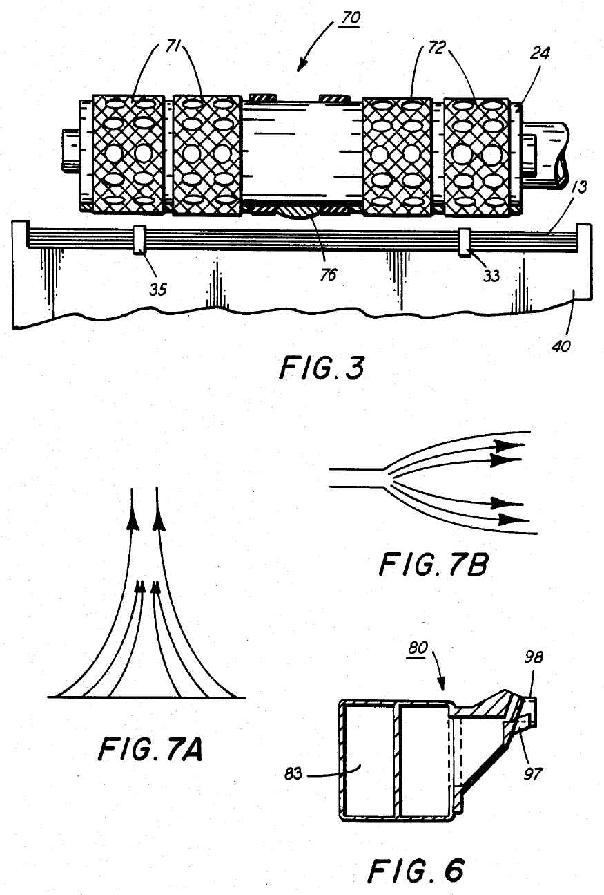
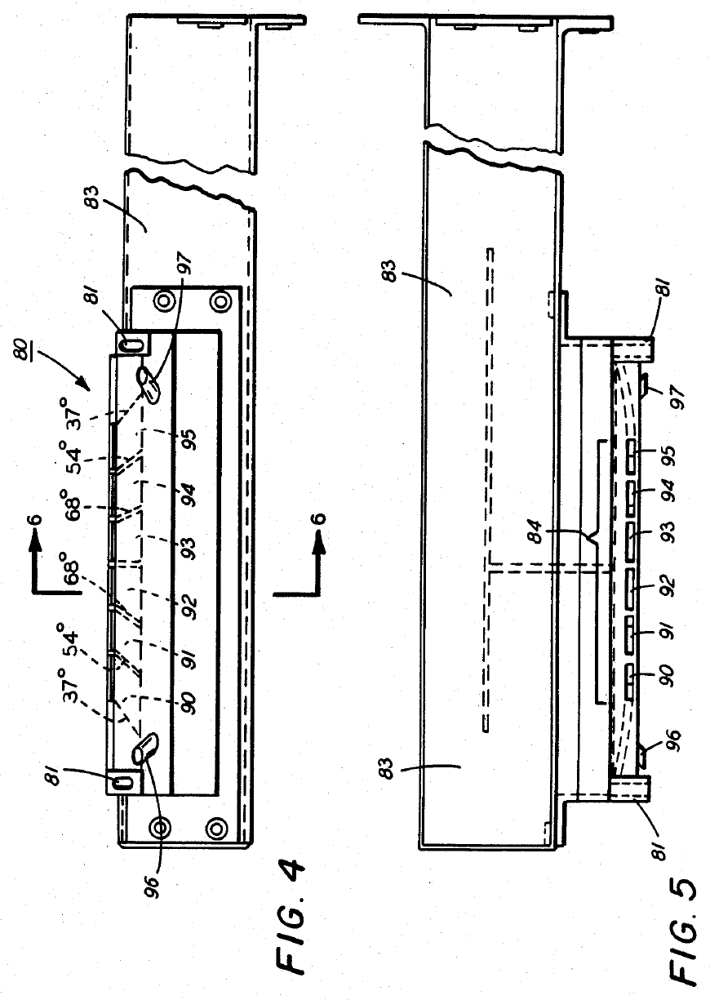

# Front air knife top vacuum corrugation feeder

Auxiliary air jets help a top vacuum corrugation feeder acquire severely downcurled leading edges.

[US4627605A · complete original PDF (11 pages)](../sources/US4627605A.pdf) · [Original PDF source](https://patentimages.storage.googleapis.com/d1/fc/3e/ff8e72be8a4abc/US4627605.pdf) · [Searchable publication](https://patents.google.com/patent/US4627605A/en) · [Espacenet](https://worldwide.espacenet.com/patent/search?q=pn%3DUS4627605A)

## Original drawings

<figure>

<figcaption>Fig. 2. Pickup head and front air knife in section at the edge of the stack. <a href="../sources/US4627605A.pdf#page=3">US4627605A, PDF p. 3</a>.</figcaption>
</figure>
<figure>

<figcaption>Figs. 3 and 6-7B. Stack and examples of the air jets and slot airflow viewed in section. <a href="../sources/US4627605A.pdf#page=4">US4627605A, PDF p. 4</a>.</figcaption>
</figure>
<figure>

<figcaption>Figs. 4-5. Air knife face and sectional layout of its outlets. <a href="../sources/US4627605A.pdf#page=5">US4627605A, PDF p. 5</a>.</figcaption>
</figure>

## Publication

- **Publication** US4627605A
- **Inventors** George J. Roller, Kendolph A. Thomas
- **Original assignee** Xerox Corporation
- **Priority** 1985-11-06 · **Filing** 1985-11-06 · **Publication** 1986-12-09
- **Application** Paper and document feeder
- **Mechanisms** Vacuum pickup, Air separation, Bending and peeling, Combined mechanisms

## What the patent describes

**Problem.** A front air knife can miss a downcurled top edge. The disclosed feedhead also avoids cycle-by-cycle vacuum timing.

**Stack presentation.** A tray presents the horizontal sheet stack below a vacuum plenum. The air knife faces the leading edge.

**Pickup sequence.** Negative pressure remains applied through perforated friction belts during the feed cycle. The upper sheet rises and bows around the center corrugating member.

**Contact surfaces.** The top face contacts the feed belts and corrugating member. Front jets act on the leading-edge region.

**Separation and overlap.** Fluffer jets lift the top layers. Auxiliary jets point into difficult downcurl regions, and the converging slot jet helps separate the sheet already held at the head.

**Handoff.** The perforated belts propel the captured sheet forward out of the tray into the feed path.

## Engineering interpretation

Jet direction deserves its own trial for downcurled film. Small pieces have little inertia, so paper-feeder air settings may displace the whole piece or the next sheet.

**Media and length evidence.** The stated media and geometry establish the application on this page. Published pickup limits for loose, cut 35 mm strips remain unverified.

## Commercial evidence

The patent shows a generic electrophotographic host. This exact auxiliary-jet configuration was not verified in a production model.

## Related patents

[US4451028A · Sheet feeding apparatus](US4451028A.md) · [EP1197450B1 · Control for a pulsed air knife for a suction belt feed mechanism](EP1197450B1.md) · [US20230202784A1 · Sheet feeder and image forming apparatus](US20230202784A1.md)

[Return to the pickup and separation archive](../index.md)
