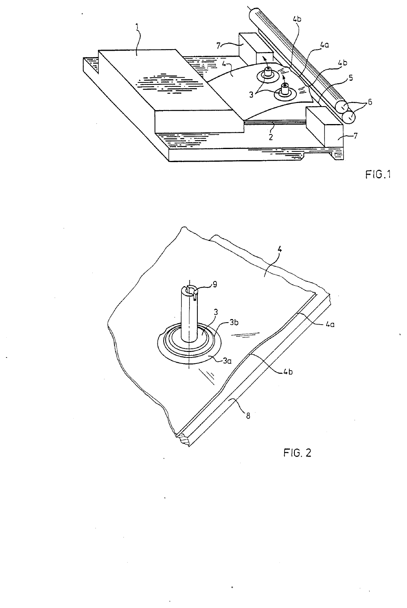
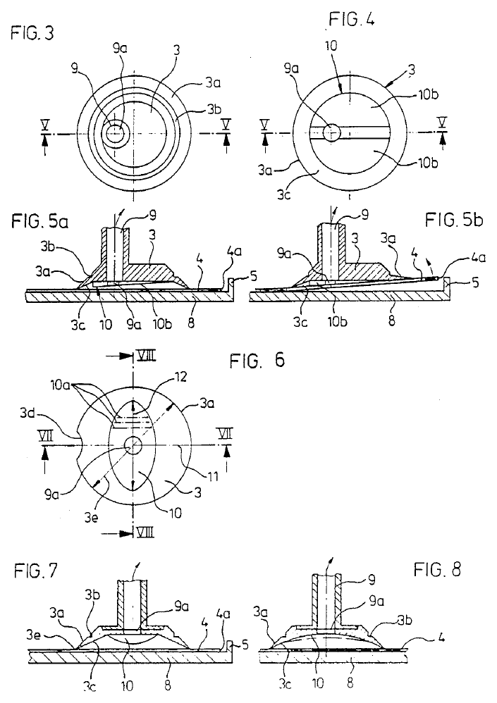

# Suction device for removing film sheets

A shaped cup lip forms a narrow vent channel in the captured edge of an X-ray film sheet.

[US4979729A · complete original PDF (6 pages)](../sources/US4979729A.pdf) · [Original PDF source](https://patentimages.storage.googleapis.com/d2/a6/f9/7cae386838c514/US4979729.pdf) · [Searchable publication](https://patents.google.com/patent/US4979729A/en) · [Espacenet](https://worldwide.espacenet.com/patent/search?q=pn%3DUS4979729A)

## Original drawings

<figure>

<figcaption>Figs. 1-2. Cassette, paired suckers, stop strip and transport roller interface. <a href="../sources/US4979729A.pdf#page=2">US4979729A, PDF p. 2</a>.</figcaption>
</figure>
<figure>

<figcaption>Figs. 3-8. Cup geometry and sectional comparison before and during suction. <a href="../sources/US4979729A.pdf#page=3">US4979729A, PDF p. 3</a>.</figcaption>
</figure>

## Publication

- **Publication** US4979729A
- **Inventors** Walter Bauer, Johann Zanner
- **Original assignee** Agfa-Gevaert AG
- **Priority** 1985-02-02 · **Filing** 1986-01-09 · **Publication** 1990-12-25
- **Application** Film cassette handling
- **Mechanisms** Vacuum pickup, Bending and peeling

## What the patent describes

**Problem.** An upper film sheet could lift the next sheet or cling to the cassette floor because the sealed interface admitted air slowly.

**Stack presentation.** A cassette or magazine holds a horizontal supply behind a stop strip. The front edge is accessible to two suckers.

**Pickup sequence.** Suckers lift the uppermost film near its front edge. Local features on a frustoconical lip displace part of the film inside the sealed cup.

**Contact surfaces.** The annular lip seals to the film surface near the edge. The lip has an internal projection above the resting film, and an outer groove can add compliance.

**Separation and overlap.** Under suction the film develops a short camber reaching its edge. The resulting channel admits ambient air between the selected film and the next sheet or the cassette floor.

**Handoff.** The pickup lifts near the stop strip and presents the film to forward transport rollers.

## Engineering interpretation

Only a local bend and a path to atmosphere are required. With perforated 35 mm stock, the trial must find a sealing area and check bend marks and leakage at the margin.

**Media and length evidence.** The stated media and geometry establish the application on this page. Published pickup limits for loose, cut 35 mm strips remain unverified.

## Commercial evidence

The specification describes an X-ray cassette-loading application. Adoption of the shaped cup in a named product remains unverified.

## Related patents

[US758453A · Pneumatic sheet-feeder.](US758453A.md) · [EP0467203B1 · Method and apparatus for moving a sheet](EP0467203B1.md) · [EP0512084B1 · Sheet-film removal device](EP0512084B1.md)

[Return to the pickup and separation archive](../index.md)
