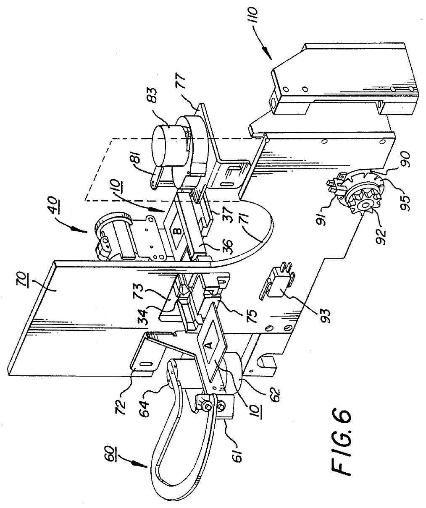
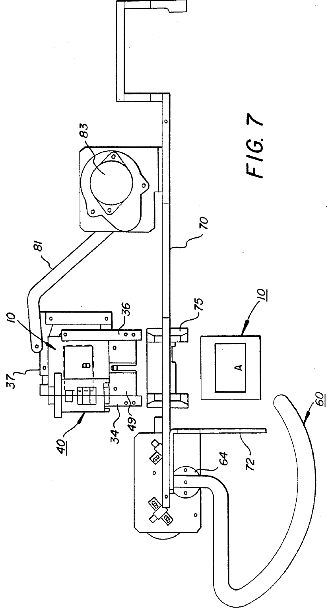

# Apparatus for automatically feeding slides into a film scanner

A rotary tray presents a pre-separated mounted slide to a pivoting load arm, then a second arm returns it to the same slot.

[US5555042A · complete original PDF (19 pages)](../sources/US5555042A.pdf) · [Original PDF source](https://patentimages.storage.googleapis.com/de/7a/08/73869160ef3f39/US5555042.pdf) · [Searchable publication](https://patents.google.com/patent/US5555042A/en) · [Espacenet](https://worldwide.espacenet.com/patent/search?q=pn%3DUS5555042A)

## Original drawings

<figure>

<figcaption>Fig. 6. Perspective of the indexed tray interface, loading and return arms, and scanner gate. <a href="../sources/US5555042A.pdf#page=7">US5555042A, PDF p. 7</a>.</figcaption>
</figure>
<figure>

<figcaption>Fig. 7. Loading axis between one tray position and the gripped slide in the scanning gate. <a href="../sources/US5555042A.pdf#page=8">US5555042A, PDF p. 8</a>.</figcaption>
</figure>

## Publication

- **Publication** US5555042A
- **Inventors** Robert S. Jones, Thomas W. Mort
- **Original assignee** Eastman Kodak Company
- **Priority** 1994-10-06 · **Filing** 1994-10-06 · **Publication** 1996-09-10
- **Application** Mounted-slide scanner
- **Mechanisms** Mechanical grip or pusher, Gate or edge selection, Presence or double-feed detection, Combined mechanisms

## What the patent describes

**Problem.** A scanner needed batch handling of mounted slides with different mount thicknesses while preserving the registration and stiffness needed for precision scanning.

**Stack presentation.** An annular tray stores one mounted slide per radial slot, with the slides held by a lower base and retaining ring. A stepper-driven gear and rotation counter align the selected slot with the load position.

**Pickup sequence.** A motor pivots load arm 60, which pushes the selected slide from its indexed slot, through guide 75, and into the jaws of the slide gate. The remaining slides stay in their tray compartments.

**Contact surfaces.** Pusher and return arm act on the mount. The guide and scanning gate locate the mount, keeping the moving contacts at the frame rather than on an unmounted emulsion surface.

**Separation and overlap.** Individual tray slots perform pre-separation. Gate, tray and arm-position sensors coordinate the next feed and detect missing or mistimed transfers. The system does not count multiple bare films at a shared outlet.

**Handoff.** Spring-biased gate jaws receive and center the slide against a stop. After scanning and repositioning the gate, a second arm returns the mount to its original slot. The controller checks that the gate is empty before indexing again.

## Engineering interpretation

This comparison isolates the value of one known unit per compartment and explicit handoff confirmation. The carousel and pusher rely on rigid mounts. The mount-specific geometry does not establish bare-film singulation.

**Media and length evidence.** The stated media and geometry establish the application on this page. Published pickup limits for loose, cut 35 mm strips remain unverified.

## Commercial evidence

The background documents existing manual slide-gate use on the Kodak Model 2400 and describes a MARON slide hopper on the Kodak RFS 2035. The rotating-tray, two-arm mechanism in this publication is a separate design. A production machine carrying that exact arrangement is unverified.

## Related patents

[US2423404A · Plate dispenser for automatic photographic machines](US2423404A.md) · [EP1267203B1 · Slide scanner with means for separating the slides from a stack](EP1267203B1.md) · [US6556276B2 · Photographic reorder system and method](US6556276B2.md)

[Return to the pickup and separation archive](../index.md)
