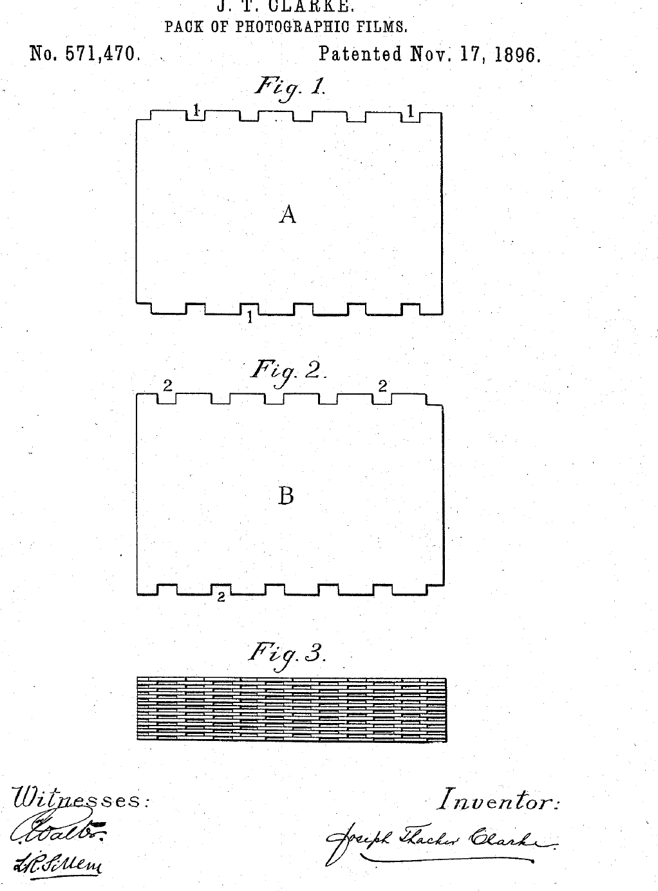

# Pack of photographic films

Alternating notches let offset selector stops release the exposed film sheet while holding the next.

[US571470A · complete original PDF (3 pages)](../sources/US571470A.pdf) · [Original PDF source](https://patentimages.storage.googleapis.com/bc/ed/00/2fa55b71c3ac43/US571470.pdf) · [Searchable publication](https://patents.google.com/patent/US571470A/en) · [Espacenet](https://worldwide.espacenet.com/patent/search?q=pn%3DUS571470A)

## Original drawings

<figure>

<figcaption>Figs. 1–3. Opposite-edge notch patterns and their alternating arrangement in the film pack. <a href="../sources/US571470A.pdf#page=1">US571470A, PDF p. 1</a>.</figcaption>
</figure>

## Publication

- **Publication** US571470A
- **Inventors** Joseph Thacher Clarke
- **Original assignee** Individual
- **Priority** No separate claim recorded · **Filing** 1890-12-29 · **Publication** 1896-11-17
- **Application** Photographic film packs
- **Mechanisms** Gate or edge selection, Mechanical grip or pusher

## What the patent describes

**Problem.** A magazine camera needed to discharge one thin, flexible photographic sheet after each exposure and leave the following sheet registered at the focal plane.

**Stack presentation.** A light-tight holder receives sheets with two different opposite-edge notch patterns, alternated through the pack. Opaque backing, when supplied separately, can share a sheet's pattern or occupy alternate positions.

**Pickup sequence.** Selector stops slide into alignment with the foremost sheet's notch pattern. When the holder is inverted, the freed sheet falls.

**Contact surfaces.** The stops act at specially notched opposite edges. The drawing specifies the sheet pattern and stack arrangement.

**Separation and overlap.** Where the foremost sheet has notches, the next sheet has solid projections. Moving the stops to the first pattern leaves them supporting the second. Using the wrong loading order would defeat the prepared alternation.

**Handoff.** Gravity clears the released sheet from the inverted holder. The supported next sheet stays ready at the exposure position.

## Engineering interpretation

Geometric keying provides selection without a vacuum head or full-face sliding feed. Factory-cut alternating edge patterns are a different premise from arbitrary processed strips. The alternating support principle could still suggest a carrier or two-stage stop test.

**Media and length evidence.** The specification gives examples of sheets 3¼, 4 and 4¾ inches long with custom notches. Those figures describe the prepared pack.

## Commercial evidence

No model or production history for this particular pack was verified. The US specification reports a British patent numbered 11,891 and dated 29 July 1890. Its US filing date and inventor were transcribed from the original facsimile. A separate priority claim is unrecorded.

## Related patents

[US735746A · Feeding device for magazine-cameras.](US735746A.md) · [US3650751A · Photographic film pack](US3650751A.md) · [US3955092A · Arrangement for respectively withdrawing a single film sheet from a stack of directly loosely superimposed film sheets](US3955092A.md)

[Return to the pickup and separation archive](../index.md)
