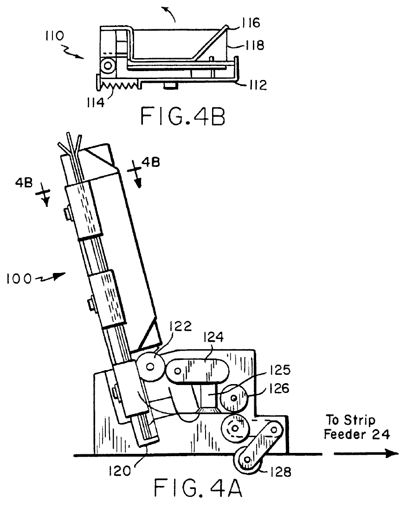
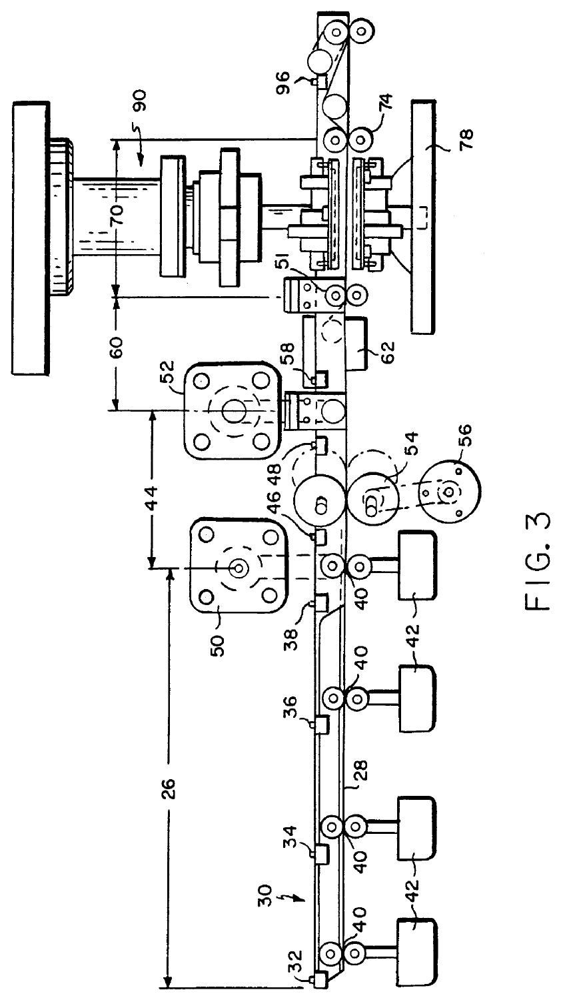

# Photographic reorder system and method

A spring-squared hopper presents cut negatives to a pivoting suction cup and an opening roller nip.

[US6556276B2 · complete original PDF (8 pages)](../sources/US6556276B2.pdf) · [Original PDF source](https://patentimages.storage.googleapis.com/b4/82/c9/b3c7cb984d234d/US6556276.pdf) · [Searchable publication](https://patents.google.com/patent/US6556276B2/en) · [Espacenet](https://worldwide.espacenet.com/patent/search?q=pn%3DUS6556276B2)

## Original drawings

<figure>

<figcaption>Figs. 4A–4B. Spring-biased hopper, pickup arm and opening roller nip. <a href="../sources/US6556276B2.pdf#page=4">US6556276B2, PDF p. 4</a>.</figcaption>
</figure>
<figure>

<figcaption>Fig. 3. Existing strip feeder with the inlet used by the multiple-strip hopper. <a href="../sources/US6556276B2.pdf#page=3">US6556276B2, PDF p. 3</a>.</figcaption>
</figure>

## Publication

- **Publication** US6556276B2
- **Inventors** Willi Staeheli, Douglas A. Kenyon, Marc Sevigny, Michael Jefferson
- **Original assignee** Gretag Imaging Inc.
- **Priority** 2001-02-09 · **Filing** 2001-06-07 · **Publication** 2003-04-29
- **Application** Loose 35 mm negative strips
- **Mechanisms** Vacuum pickup, Friction pickup, Presence or double-feed detection, Combined mechanisms

## What the patent describes

**Problem.** A photographic reorder station needed to scan batches of negatives without asking an operator to insert and orient each piece in its existing strip track.

**Stack presentation.** The controller sets the width. A spring-biased bottom/outboard plate squares loose strips, a hinged upper guide carries a foam or rubber roller, and the aligned ends rest against a stop.

**Pickup sequence.** An infrared presence detector starts a pickup cycle. A solenoid- or air-actuated arm pivots vacuum cup 125 into the presented strip and swings the selected strip toward the exit.

**Contact surfaces.** The guide and roller position the stack. The cup grips a localized area of the film face. Drive roller 126 and movable pressure roller 128 contact opposite film faces to establish the nip.

**Separation and overlap.** The cup transports one selected piece away from the rest of the mechanically registered stack. The infrared detector reports presence at the hopper; the embodiment gives no separate overlap measurement.

**Handoff.** As the arm delivers the strip, roller 128 pivots up against driven roller 126. The nip moves the strip into strip feeder 24. The controller and receiver sequence is important because the picker and the existing track have different motions.

## Engineering interpretation

This is a direct precedent for a short transfer from a loose stack into a controlled nip. An adjustable arm path and a near receiver give ways to test the shortest specimen. Cup sealing on curl, transfer overlap and neighboring sheets rising together remain important measurements.

**Media and length evidence.** Claim 20 covers a strip with at least one frame. The drawings illustrate a conventional 135 strip with three frames. The patent gives no measured performance for a stack of loose single frames.

## Commercial evidence

No independently documented Gretag product or service assembly was found that could be matched to the spring plate, arm and two-roller handoff. Pacific Image's PowerFilm Plus is a separate commercially documented comparison.

## Related patents

[US7950654B2 · Film handling system with elongated film guide](US7950654B2.md) · [US4979729A · Suction device for removing film sheets](US4979729A.md) · [US5555042A · Apparatus for automatically feeding slides into a film scanner](US5555042A.md) · [EP0750228A1 · Photographic printing apparatus](EP0750228A1.md)

**Family publications.** [US20020110374A1](https://patents.google.com/patent/US20020110374A1/en)

[Return to the pickup and separation archive](../index.md)
