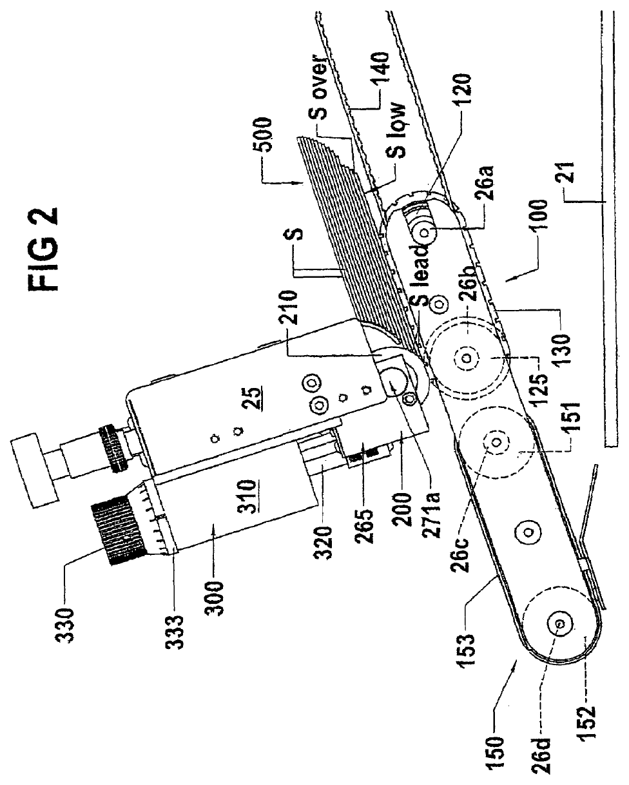

# Friction sheet feeding machine with reversible driven retard roller

An independently driven upper retard roller lets the operator choose how its surface moves against the next sheet.

[US6932338B1 · complete original PDF (11 pages)](../sources/US6932338B1.pdf) · [Original PDF source](https://patentimages.storage.googleapis.com/64/9e/da/a4cc20380d0ed7/US6932338.pdf) · [Searchable publication](https://patents.google.com/patent/US6932338B1/en) · [Espacenet](https://worldwide.espacenet.com/patent/search?q=pn%3DUS6932338B1)

## Original drawings

<figure>

<figcaption>Fig. 2. Section through the lowest-sheet belt, next-sheet retard roller, height dial and onward conveyor. <a href="../sources/US6932338B1.pdf#page=3">US6932338B1, PDF p. 3</a>.</figcaption>
</figure>

## Publication

- **Publication** US6932338B1
- **Inventors** William L. Popejoy, Perry D. Bergman
- **Original assignee** Streamfeeder LLC
- **Priority** 2002-11-01 · **Filing** 2003-10-30 · **Publication** 2005-08-23
- **Application** Paper and document feeder
- **Mechanisms** Friction pickup, Retard pad or roller, Gate or edge selection, Combined mechanisms

## What the patent describes

**Problem.** A single direction of upper-roller motion does not suit all materials. Stock thickness, stiffness and tack alter the balance between successful extraction, multi-feed and edge damage.

**Stack presentation.** The tray supports a generally steep stack with its leading edges aligned against a cross member. The inclination urges the stock toward the drive and the adjustable gate.

**Pickup sequence.** Friction rollers and a belt grip the downward-facing surface of the lowest sheet and pull it out from beneath the stack.

**Contact surfaces.** The upper retard roller touches the next sheet's leading edge and any exposed part of its upper face. The lower friction belt touches the outgoing sheet's lower face.

**Separation and overlap.** An auxiliary motor sets the retard surface either with or against the feed direction at the point of contact. The roller gap is adjustable to stock thickness and stiffness. The preferred control energizes the upper drive only while the lower feed runs.

**Handoff.** A driven conveyor receives the individual sheet downstream from the friction belt and carries it onward for timed collation.

## Engineering interpretation

Independent speed and direction make it possible to characterize a difficult stack without changing the pickup drive. Here reversal is a setup choice rather than a detected-jam recovery routine. Sliding or countercurrent contact near a 35 mm cut edge can cause marking or buckling.

**Media and length evidence.** The stated media and geometry establish the application on this page. Published pickup limits for loose, cut 35 mm strips remain unverified.

## Commercial evidence

The patent discloses a collating feeder and compares conventional equipment. A named commercial model with its reversible assembly remains unverified.

## Related patents

[US3469834A · Sheet feeder and separator apparatus](US3469834A.md) · [US3966189A · Toggling retard pad](US3966189A.md) · [EP1721846B1 · Media separator mechanism](EP1721846B1.md) · [US7819396B2 · Sheet separating apparatus and method of separating sheets](US7819396B2.md)

[Return to the pickup and separation archive](../index.md)
