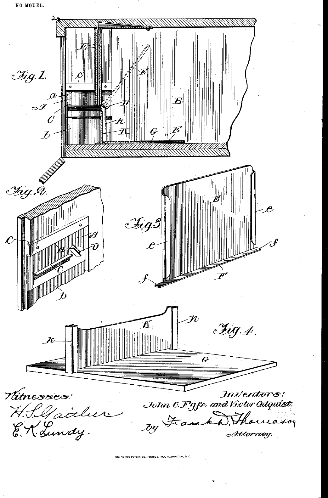

# Feeding device for magazine-cameras.

Inclined lugs tip the leading plate holder off its shelf and into paired gravity guides after exposure.

[US735746A · complete original PDF (4 pages)](../sources/US735746A.pdf) · [Original PDF source](https://patentimages.storage.googleapis.com/18/df/29/855711ab28b6ce/US735746.pdf) · [Searchable publication](https://patents.google.com/patent/US735746A/en) · [Espacenet](https://worldwide.espacenet.com/patent/search?q=pn%3DUS735746A)

## Original drawings

<figure>

<figcaption>Figs. 1–4. Section through the magazine camera, a side ledge and stop lug, a plate holder, and the guided receiving tray. <a href="../sources/US735746A.pdf#page=1">US735746A, PDF p. 1</a>.</figcaption>
</figure>

## Publication

- **Publication** US735746A
- **Inventors** John C Fyfe, Victor Odquist
- **Original assignee** Individual
- **Priority** 1902-11-06 · **Filing** 1902-11-06 · **Publication** 1903-08-11
- **Application** Magazine cameras
- **Mechanisms** Gate or edge selection

## What the patent describes

**Problem.** In plate magazine cameras, exposed plates could refuse to drop or fall out of alignment, obstructing later exposures or breaking glass.

**Stack presentation.** Individual upright metal holders run on two side ledges. Their lower flanges space the holders, support each plate, and help shield its lower edge from incident light.

**Pickup sequence.** The forward holder is at the exposure point with only the rear part of each projecting tab still supported. When its upper edge is released after exposure, pressure from behind and the inclined stop lugs make it tip forward.

**Contact surfaces.** The side ledges, upper restraint, lugs and catch chutes interact with the rigid holder. The sensitive plate is supported at its edges by its holder.

**Separation and overlap.** The transition from the support ledges into the catch chutes is located at the forward holder. The patent describes guided release and stacking of individual carriers, without specifying a detector or a bare-film pickup head.

**Handoff.** Projecting tabs enter the paired vertical chutes of a removable tray. The exposed holders settle into a controlled pile.

## Engineering interpretation

The useful precedent is a mechanical constraint that stays engaged as a piece changes direction. Rigid tabs and individual holders make this a carrier analogy. Loose 35 mm negatives would require another way to provide the same constrained handoff.

**Media and length evidence.** The stated media and geometry establish the application on this page. Published pickup limits for loose, cut 35 mm strips remain unverified.

## Commercial evidence

The specification identifies magazine plate cameras as an established product category. A production camera implementing these exact lugs and holders is unverified.

## Related patents

[US2423404A · Plate dispenser for automatic photographic machines](US2423404A.md) · [US5555042A · Apparatus for automatically feeding slides into a film scanner](US5555042A.md)

[Return to the pickup and separation archive](../index.md)
