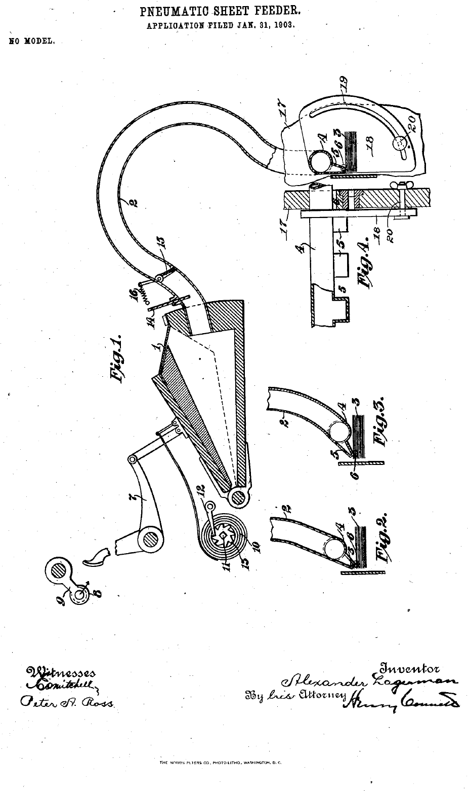

# Pneumatic sheet-feeder.

An angled suction mouthpiece lifts and curls the edge of the top sheet for a gripper.

[US758453A · complete original PDF (3 pages)](../sources/US758453A.pdf) · [Original PDF source](https://patentimages.storage.googleapis.com/47/18/b1/27ee89379ea0cd/US758453.pdf) · [Searchable publication](https://patents.google.com/patent/US758453A/en) · [Espacenet](https://worldwide.espacenet.com/patent/search?q=pn%3DUS758453A)

## Original drawings

<figure>

<figcaption>Figs. 1-4. The bellows, suction pipe and adjustable mouthpiece at three inclinations. <a href="../sources/US758453A.pdf#page=1">US758453A, PDF p. 1</a>.</figcaption>
</figure>

## Publication

- **Publication** US758453A
- **Inventors** Alexander Lagerman
- **Original assignee** Individual
- **Priority** 1903-01-31 · **Filing** 1903-01-31 · **Publication** 1904-04-26
- **Application** Paper and document feeder
- **Mechanisms** Vacuum pickup, Bending and peeling, Mechanical grip or pusher

## What the patent describes

**Problem.** Pressure alone could miss the sheet or lift several. The mouthpiece angle and vacuum were adjustable to suit paper stiffness.

**Stack presentation.** The patent places the mouthpieces just above an exposed edge of a paper pile. Stack support and advance are left to the host machine.

**Pickup sequence.** A spring expands bellows to apply suction through flat-faced mouthpieces. Setting the faces at an incline pulls a flexible top edge up to meet them.

**Contact surfaces.** The mouthpiece face contacts a narrow area near the sheet edge. A downstream gripper takes hold of the turned-up edge.

**Separation and overlap.** Curling the captured edge lets the next sheet remain in the pile. Stiffer board can be picked with a parallel face. An adjustable damper limits excessive suction.

**Handoff.** Grippers pass between the spaced mouthpieces and seize the raised edge. Their drive is outside the drawings.

## Engineering interpretation

Cup angle and suction provide independent ways to tune pickup. Trials with film should measure how pre-existing curl affects sealing, and how much clearance the gripper requires on a single frame.

**Media and length evidence.** The stated media and geometry establish the application on this page. Published pickup limits for loose, cut 35 mm strips remain unverified.

## Commercial evidence

The patent identifies printing and paper-handling machine classes. Product adoption remains unverified.

## Related patents

[US1646681A · Automatic suction sheet-feeding machine](US1646681A.md) · [US4979729A · Suction device for removing film sheets](US4979729A.md) · [EP0467203B1 · Method and apparatus for moving a sheet](EP0467203B1.md)

[Return to the pickup and separation archive](../index.md)
