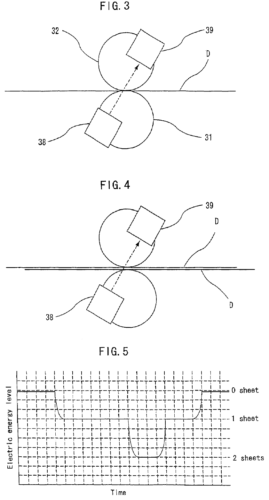
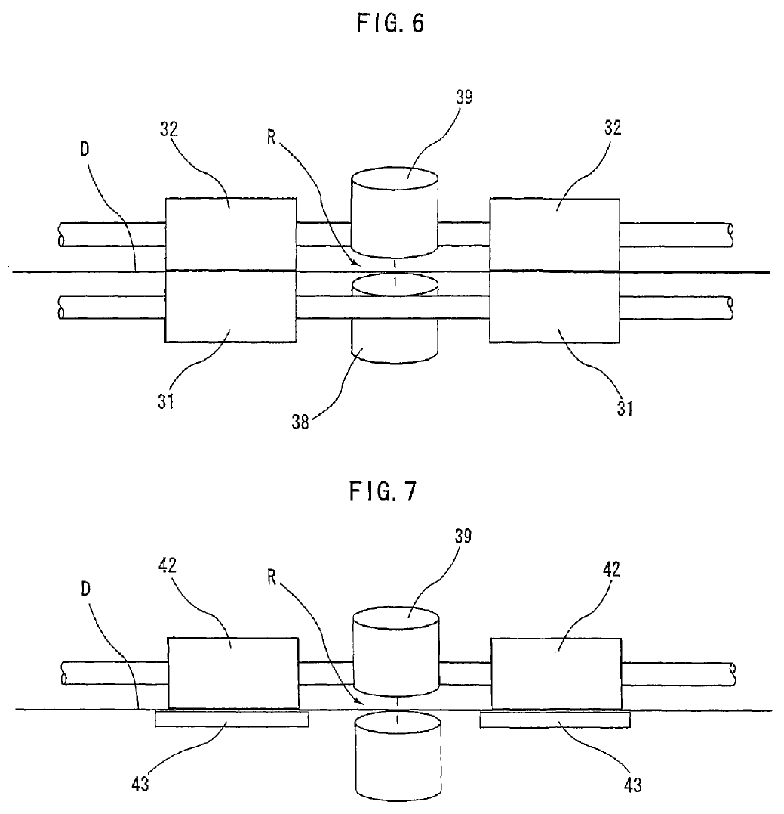

# Sheet feeder with ultrasonic double feed detector

An ultrasonic beam checks for an overlapping sheet beside a nip that suppresses flutter.

[US7654522B2 · complete original PDF (15 pages)](../sources/US7654522B2.pdf) · [Original PDF source](https://patentimages.storage.googleapis.com/75/6e/57/3b1363398cb16d/US7654522.pdf) · [Searchable publication](https://patents.google.com/patent/US7654522B2/en) · [Espacenet](https://worldwide.espacenet.com/patent/search?q=pn%3DUS7654522B2)

## Original drawings

<figure>

<figcaption>Figs. 3–5. Acoustic path through one and two sheets and a conceptual receiver signal versus time. <a href="../sources/US7654522B2.pdf#page=4">US7654522B2, PDF p. 4</a>.</figcaption>
</figure>
<figure>

<figcaption>Figs. 6–7. Beam location between adjacent lateral holding pairs, including a feed-roller and pad arrangement. <a href="../sources/US7654522B2.pdf#page=5">US7654522B2, PDF p. 5</a>.</figcaption>
</figure>

## Publication

- **Publication** US7654522B2
- **Inventors** Kazumasa Tonami
- **Original assignee** Sharp Corp
- **Priority** 2006-04-07 · **Filing** 2007-04-05 · **Publication** 2010-02-02
- **Application** Paper and document feeder
- **Mechanisms** Presence or double-feed detection, Retard pad or roller, Combined mechanisms

## What the patent describes

**Problem.** A free sheet can vibrate as it moves through an ultrasonic measuring point, weakening the received signal and causing a false multi-feed indication.

**Stack presentation.** The disclosed automatic document feeder begins with a tray of sheet documents, a pickup roller and downstream supply and separating rollers.

**Pickup sequence.** The pick and separator normally release one document into opposed feed and press rollers. The ultrasonic assembly measures both normal feed and any overlapping sheets that escape that separation.

**Contact surfaces.** Feed and press rolls touch the media. The transmitter and receiver are on opposite sides of an adjacent supported region and make no contact with the media.

**Separation and overlap.** One sheet reduces received ultrasonic energy. An air layer between overlapping sheets can cause a larger reduction. Comparing the signal with a threshold detects a double; placing the beam near or between roller pairs suppresses sheet motion at that point.

**Handoff.** A valid single sheet continues to the registration rollers and optical reading position. The method observes a failed separation rather than releasing the second sheet itself.

## Engineering interpretation

Useful placement principle for the scope of a film feeder. Clean face-to-face contact, curl, perforations and the short overlap of two staggered images could all change the measured signal. Establish the detection margin on the actual film before relying on an office-media threshold.

**Media and length evidence.** The stated media and geometry establish the application on this page. Published pickup limits for loose, cut 35 mm strips remain unverified.

## Commercial evidence

The patent gives an automatic document feeder as the tested context. A named retail sensor or production machine with the same geometry was not verified.

## Related patents

[US3469834A · Sheet feeder and separator apparatus](US3469834A.md) · [EP0405466B1 · Single sheet picking and transport mechanism](EP0405466B1.md) · [US6556276B2 · Photographic reorder system and method](US6556276B2.md)

[Return to the pickup and separation archive](../index.md)
