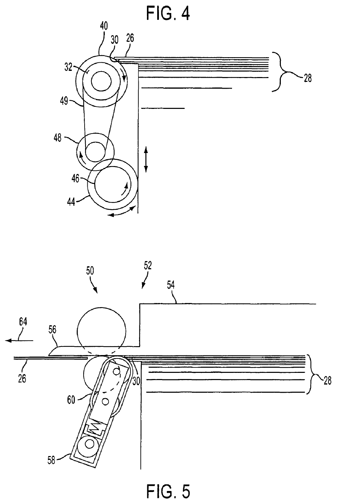
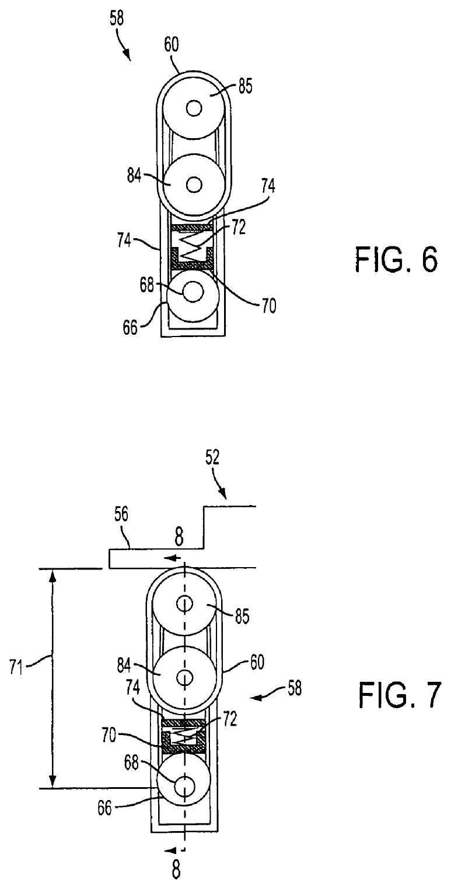

# Sheet separating apparatus and method of separating sheets

A vacuum shuttle and an edge-retard belt cooperate, then the belt indexes a fresh contact area on return.

[US7819396B2 · complete original PDF (9 pages)](../sources/US7819396B2.pdf) · [Original PDF source](https://patentimages.storage.googleapis.com/e0/64/a8/aea8ea992ad8f7/US7819396.pdf) · [Searchable publication](https://patents.google.com/patent/US7819396B2/en) · [Espacenet](https://worldwide.espacenet.com/patent/search?q=pn%3DUS7819396B2)

## Original drawings

<figure>

<figcaption>Figs. 4–5. Roller-based renewal as a stack rises and a shuttle-based variant with an edge-retard belt. <a href="../sources/US7819396B2.pdf#page=4">US7819396B2, PDF p. 4</a>.</figcaption>
</figure>
<figure>

<figcaption>Figs. 6–7. Low- and high-force positions of the belt, spring and cam in the separation cycle. <a href="../sources/US7819396B2.pdf#page=5">US7819396B2, PDF p. 5</a>.</figcaption>
</figure>

## Publication

- **Publication** US7819396B2
- **Inventors** Youti Kuo, Kenneth W. Luff, Ernest L. DiNatale
- **Original assignee** Xerox Corporation
- **Priority** 2005-08-25 · **Filing** 2005-08-25 · **Publication** 2010-10-26
- **Application** Paper and document feeder
- **Mechanisms** Vacuum pickup, Retard pad or roller, Combined mechanisms

## What the patent describes

**Problem.** A fixed edge pad wears in one place and can keep rubbing a following sheet while the feeder resets. Excess vacuum can make an untreated adjacent sheet follow the feed.

**Stack presentation.** The paper stack sits below the vacuum head with the retard assembly against the exit edge. In a roller alternative, upward stack adjustment indexes the retard surface between picks.

**Pickup sequence.** The vacuum head holds and translates the exposed top sheet out of the pile. A cam coupled to that motion loads the retard assembly against the underlying sheet at the appropriate time.

**Contact surfaces.** The head contacts the upper sheet's surface. Rubber on a roller or belt contacts a narrow region at the lead edge of the underlying sheet.

**Separation and overlap.** The retard carrier applies more force during extraction. After the outgoing sheet clears, return motion reduces the load and a one-way clutch lets a belt advance to expose a fresh part of its surface.

**Handoff.** The vacuum shuttle takes the selected sheet into the outward feed path. The driven retard surface can index independently of the selected sheet during reset.

## Engineering interpretation

The edge-only holding idea and timed unloading are worth testing with a film-safe pad. A 35 mm cut frame can curl away from a narrow contact, or its exposed face can extend right to that edge. Pad wear, residue and spacing still need checking.

**Media and length evidence.** The stated media and geometry establish the application on this page. Published pickup limits for loose, cut 35 mm strips remain unverified.

## Commercial evidence

The patent describes printer and copier mechanisms. Product adoption of the illustrated cyclic edge belt was not independently verified.

## Related patents

[US6556276B2 · Photographic reorder system and method](US6556276B2.md) · [EP0521459A1 · Device for feeding single sheets out of a stack of film sheets](EP0521459A1.md) · [US6932338B1 · Friction sheet feeding machine with reversible driven retard roller](US6932338B1.md)

[Return to the pickup and separation archive](../index.md)
