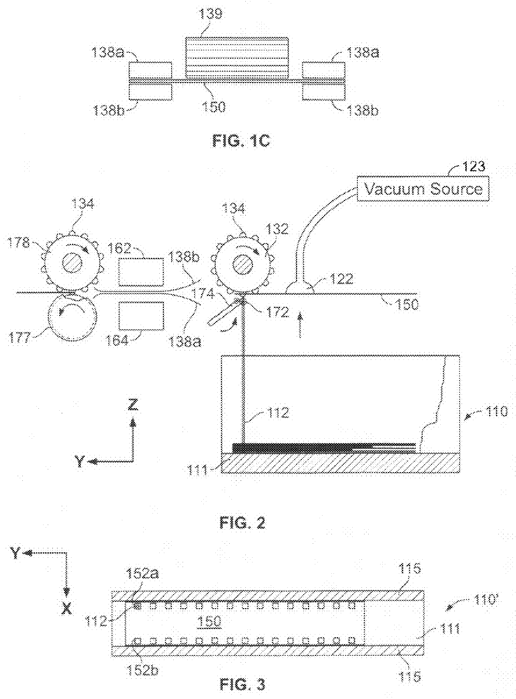
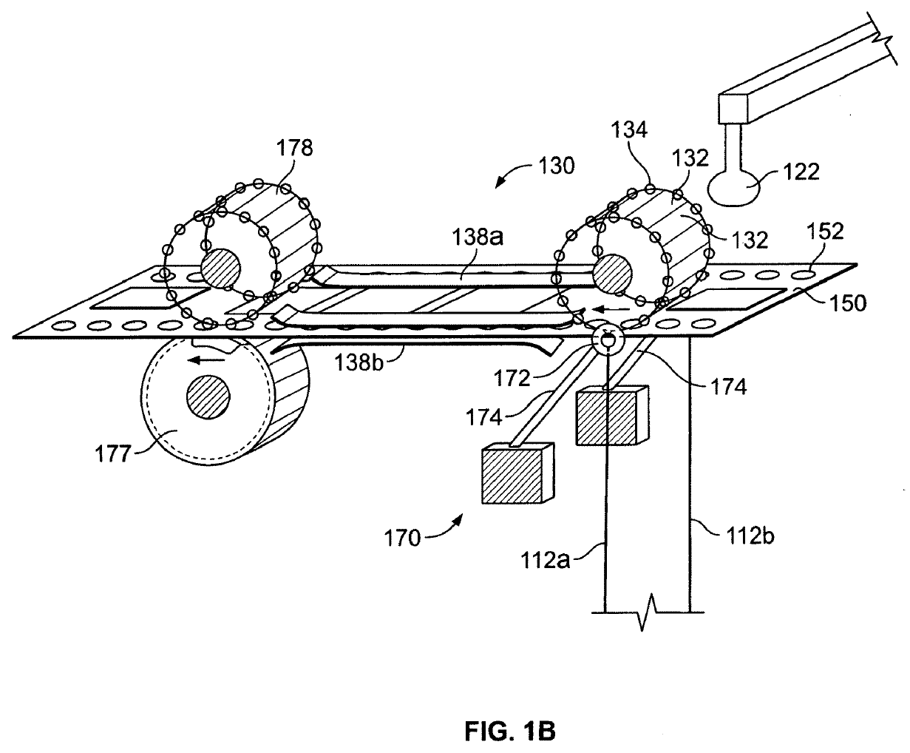
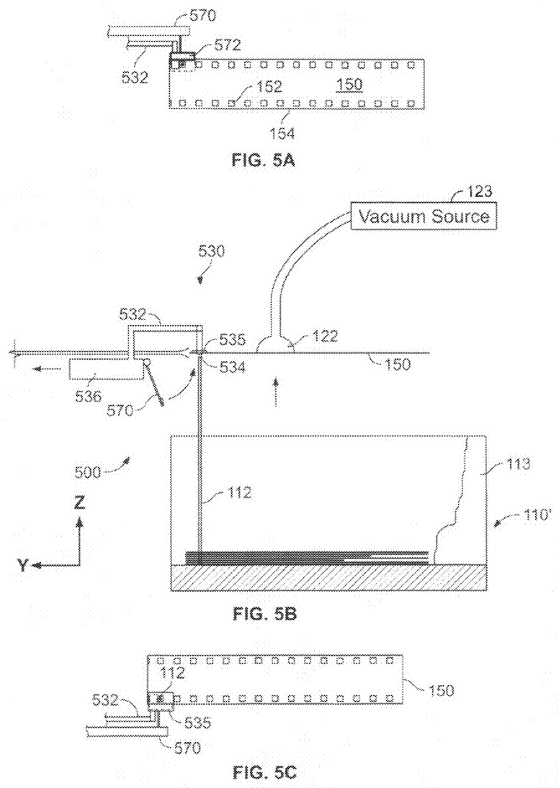

# Film handling system with elongated film guide

A vacuum head lifts one cut negative through a registered stack and transfers it to a perforation drive.

[US7950654B2 · complete original PDF (30 pages)](../sources/US7950654B2.pdf) · [Original PDF source](https://patentimages.storage.googleapis.com/c5/94/b1/d0c01672f120f3/US7950654.pdf) · [Searchable publication](https://patents.google.com/patent/US7950654B2/en) · [Espacenet](https://worldwide.espacenet.com/patent/search?q=pn%3DUS7950654B2)

## Original drawings

<figure>

<figcaption>Figs. 1C, 2 and 3. Vacuum lift from the stack, sprocket transfer and alternative tray alignment. <a href="../sources/US7950654B2.pdf#page=4">US7950654B2, PDF p. 4</a>.</figcaption>
</figure>
<figure>

<figcaption>Fig. 1B. Perforation drive, backing rollers and guide rails. <a href="../sources/US7950654B2.pdf#page=3">US7950654B2, PDF p. 3</a>.</figcaption>
</figure>
<figure>

<figcaption>Figs. 5A–5C. Variant using a moving single-sprocket grip and a single stack post. <a href="../sources/US7950654B2.pdf#page=6">US7950654B2, PDF p. 6</a>.</figcaption>
</figure>

## Publication

- **Publication** US7950654B2
- **Inventors** Michael Tenbrock
- **Original assignee** Individual
- **Priority** 2006-04-28 · **Filing** 2009-12-19 · **Publication** 2011-05-31
- **Application** Loose 35 mm negative strips
- **Mechanisms** Vacuum pickup, Air separation, Mechanical grip or pusher, Combined mechanisms

## What the patent describes

**Problem.** Processed 35 mm negatives vary in length and curl. The invention addresses batch loading without relying on the broad face pressure of conventional paper feed rollers.

**Stack presentation.** In one embodiment, a tray carries a stack on guide posts matching the film perforations. Another tray uses a single post and side walls. The posts run most of the way to the receiver so lateral registration is maintained during the lift.

**Pickup sequence.** A vacuum head adheres to the top strip and raises it from the tray. Other disclosed arrangements can change its orientation before transfer.

**Contact surfaces.** The vacuum cup meets one face. The posts, receiving sprockets, guides and small pressure rollers locate the perforated margins. Some auxiliary guides are arranged to clear already planar film.

**Separation and overlap.** An optional air supply blows toward the cut leading edges to loosen a second sheet that is sticking to the first as the vacuum head lifts the selected negative.

**Handoff.** In the roller embodiment, backing rollers press the strip perforations against the drive sprockets, then the vacuum head releases. A second embodiment uses a movable engagement on a single sprocket hole and carries it along the path.

## Engineering interpretation

This is the clearest reference for testing an independently timed vacuum–air–receiver sequence on loose cut film. Threading every strip onto two posts may impede fast loading or catch damaged perforations. Test a side-reference variant when the cut end falls close to the first usable hole.

**Media and length evidence.** The disclosure discusses processed 35 mm negatives, variable cutting and strips around 5.94 inches long in one context. It does not establish reliable pickup of individual frames or a validated minimum across the forms shown.

## Commercial evidence

The searched patent-family records establish versions of the design. No manufacturer manual, parts catalog or physical scanner was found that identifies the illustrated tray and handoff as a shipped assembly.

## Related patents

[US6556276B2 · Photographic reorder system and method](US6556276B2.md) · [US4979729A · Suction device for removing film sheets](US4979729A.md) · [US4627605A · Front air knife top vacuum corrugation feeder](US4627605A.md) · [US20230202784A1 · Sheet feeder and image forming apparatus](US20230202784A1.md)

[Return to the pickup and separation archive](../index.md)
