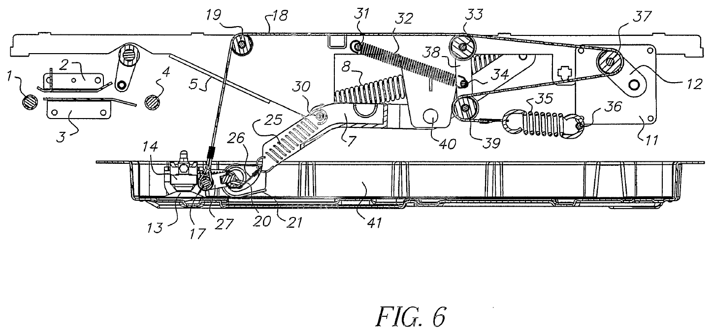
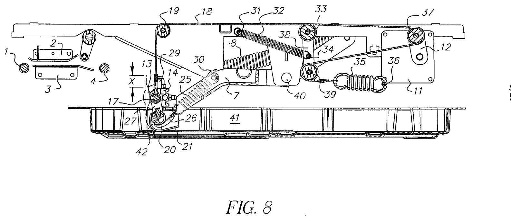
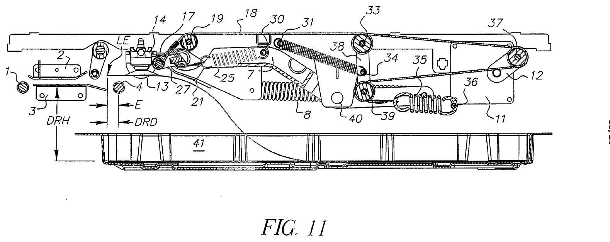

# Film sheet supply system

A pivoting heel holds the stack while sliding cup carriers lift and corrugate the selected leading edge.

[WO2004079448A1 · complete original PDF (34 pages)](../sources/WO2004079448A1.pdf) · [Original PDF source](https://patentimages.storage.googleapis.com/98/45/56/1963afdaff5c6b/WO2004079448A1.pdf) · [Searchable publication](https://patents.google.com/patent/WO2004079448A1/en) · [Espacenet](https://worldwide.espacenet.com/patent/search?q=pn%3DWO2004079448A1)

## Original drawings

<figure>

<figcaption>Fig. 6. The heel is seated and the suction cups have engaged the film. <a href="../sources/WO2004079448A1.pdf#page=22">WO2004079448A1, PDF p. 22</a>.</figcaption>
</figure>
<figure>

<figcaption>Fig. 8. Maximum bend state with the cup carriage displacement called out. <a href="../sources/WO2004079448A1.pdf#page=24">WO2004079448A1, PDF p. 24</a>.</figcaption>
</figure>
<figure>

<figcaption>Fig. 11. Home position presenting the leading edge between the receiving rollers. <a href="../sources/WO2004079448A1.pdf#page=27">WO2004079448A1, PDF p. 27</a>.</figcaption>
</figure>

## Publication

- **Publication** WO2004079448A1
- **Inventors** Brian Nelson
- **Original assignee** Eastman Kodak Company
- **Priority** 2003-02-28 · **Filing** 2004-02-26 · **Publication** 2004-09-16
- **Application** Laser film imager
- **Mechanisms** Vacuum pickup, Bending and peeling, Combined mechanisms

## What the patent describes

**Problem.** Smooth photosensitive sheets can cling in a cartridge. The top edge must arrive between the open rollers at a known height as the stack empties.

**Stack presentation.** A film cartridge locates the stack below the pickup. Spring-loaded heel pads run down to contact the top of the remaining stock.

**Pickup sequence.** The suction cup plate pivots relative to the heel. A cable drive changes the plate angle after the heel seats, and spring-guided cup carriages slide as the film wraps.

**Contact surfaces.** Heel pads bear on the film. Vacuum cups seal to the edge region and silicone loops can press locally on the lifted span.

**Separation and overlap.** The heel holds the sheet back while the cups lift a free edge. Repeated small movements and loops that add an edge wave allow multiple layers to slip relative to each other before final lift.

**Handoff.** Pivot rollers meet the frame shelf to level and guide the lifted edge above the drive roller. The idler closes around the edge before the cups release it.

## Engineering interpretation

This is a useful example of curl control combined with a positive physical handoff. The heel, cup and loop spacing would need to shrink for short negatives, with contact and permanent bend marks checked separately.

**Media and length evidence.** The stated media and geometry establish the application on this page. Published pickup limits for loose, cut 35 mm strips remain unverified.

## Commercial evidence

Kodak's earlier DryView 8100 service manual documents vacuum cups, a heel pad, separator tabs and roller handoff. That establishes a deployed architecture in the same product family. Use of this later patent's silicone loops and detailed cycle remains unverified. [Kodak DryView 8100 service manual, sections 4-6 and 7-6-5](https://www.scribd.com/document/522250393/sm8100C)

## Related patents

[EP0467203B1 · Method and apparatus for moving a sheet](EP0467203B1.md) · [EP0512084B1 · Sheet-film removal device](EP0512084B1.md) · [WO2007019045A1 · Imaging apparatus and method for separating individual sheets in a media supply](WO2007019045A1.md)

[Return to the pickup and separation archive](../index.md)
