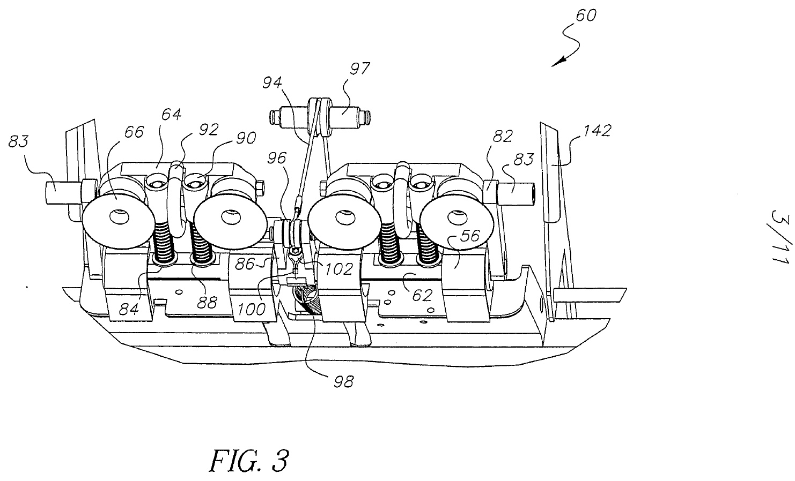
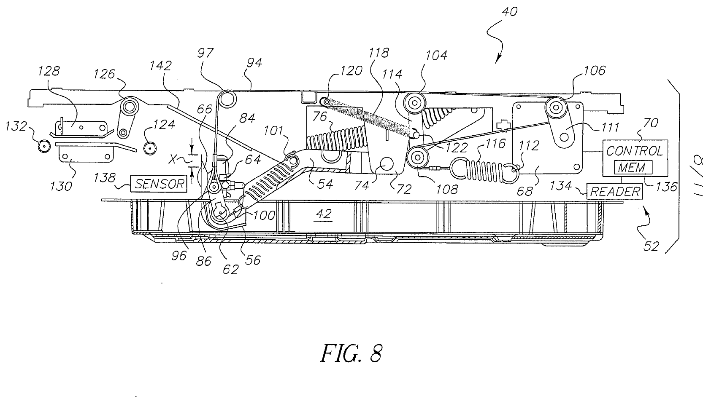
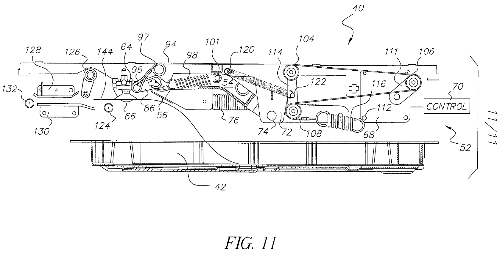

# Imaging apparatus and method for separating individual sheets in a media supply

The actuator vibrates the captured film edge at controlled frequencies before lifting it free of the stack.

[WO2007019045A1 · complete original PDF (37 pages)](../sources/WO2007019045A1.pdf) · [Original PDF source](https://patentimages.storage.googleapis.com/86/05/6d/1dbe34000e60db/WO2007019045A1.pdf) · [Searchable publication](https://patents.google.com/patent/WO2007019045A1/en) · [Espacenet](https://worldwide.espacenet.com/patent/search?q=pn%3DWO2007019045A1)

## Original drawings

<figure>

<figcaption>Fig. 3. Isometric view of the suction cup carriages, shaft and silicone loops. <a href="../sources/WO2007019045A1.pdf#page=26">WO2007019045A1, PDF p. 26</a>.</figcaption>
</figure>
<figure>

<figcaption>Fig. 8. Pickup head at maximum bend, the position used for oscillation in one embodiment. <a href="../sources/WO2007019045A1.pdf#page=31">WO2007019045A1, PDF p. 31</a>.</figcaption>
</figure>
<figure>

<figcaption>Fig. 11. The cartridge and the staged roller handoff after film pickup. <a href="../sources/WO2007019045A1.pdf#page=34">WO2007019045A1, PDF p. 34</a>.</figcaption>
</figure>

## Publication

- **Publication** WO2007019045A1
- **Inventors** Troy A. Giese
- **Original assignee** Eastman Kodak Company
- **Priority** 2005-08-03 · **Filing** 2006-07-25 · **Publication** 2007-02-15
- **Application** Laser film imager
- **Mechanisms** Vacuum pickup, Bending and peeling, Combined mechanisms

## What the patent describes

**Problem.** Electrostatic attraction and film coatings can make adjacent sheets follow the one acquired by a vacuum pickup.

**Stack presentation.** A cartridge locates the film pile. Spring-loaded heel pads establish the local top level during approach.

**Pickup sequence.** The motor and cable move a vacuum cup carriage relative to the heel. In the illustrated cycle the vacuum-held film edge is first bent before the controller oscillates the head.

**Contact surfaces.** Heel pads contact exposed film. Suction cups grip the selected sheet and silicone loops can add a corrugation to the leading edge.

**Separation and overlap.** The stated principle is to excite film near a characteristic bending frequency. The controller can choose one frequency or sweep a range intended to include different numbers or types of clinging sheets.

**Handoff.** The drive retracts the pickup after the separation cycle. A pivoting idler clamps the film against the drive roller before vacuum is released.

## Engineering interpretation

This is a controllable way to test agitation within a peel cycle. In mixed 35 mm strips, frame count, thickness and curl change effective stiffness and resonant response, so the cited tuning does not transfer directly.

**Media and length evidence.** The stated media and geometry establish the application on this page. Published pickup limits for loose, cut 35 mm strips remain unverified.

## Commercial evidence

Service manuals for earlier DryView imagers establish commercial heel-and-cup pickups. Use of the disclosed frequency-tuned vibration in a named production imager remains unverified.

## Related patents

[WO2004079448A1 · Film sheet supply system](WO2004079448A1.md) · [EP0512084B1 · Sheet-film removal device](EP0512084B1.md) · [US4979729A · Suction device for removing film sheets](US4979729A.md)

[Return to the pickup and separation archive](../index.md)
